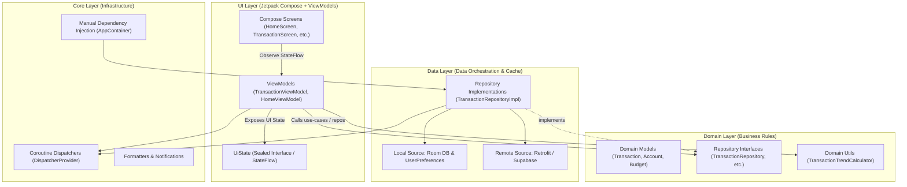

# 🎓 Kotlin & Mobile Development Journey
### Learning Modern Android Development Through the SmartMoney Project

Welcome to your personalized Kotlin and Android mobile engineering curriculum! This guide connects the theoretical concepts of Kotlin and modern Android architecture directly to the **SmartMoney** codebase that you have built.

---

## 🗺️ Curriculum Roadmap

| Module | Title | Core Concepts Covered | Codebase Highlights |
| :--- | :--- | :--- | :--- |
| **[01. Kotlin Essentials](file:///home/frank/AndroidStudioProjects/smartmoney/kotlin%20education/01_kotlin_essentials.md)** | Language Foundations | `val`/`var`, Null Safety, Data Classes, Sealed Interfaces, Lambdas, Higher-Order Functions | [`Transaction.kt`](file:///home/frank/AndroidStudioProjects/smartmoney/app/src/main/java/com/example/smartmoney/domain/model/Transaction.kt), [`CurrencyUtils.kt`](file:///home/frank/AndroidStudioProjects/smartmoney/app/src/main/java/com/example/smartmoney/core/util/CurrencyUtils.kt) |
| **[02. Clean Architecture & MVVM](file:///home/frank/AndroidStudioProjects/smartmoney/kotlin%20education/02_clean_architecture_and_mvvm.md)** | Architecture & Design Patterns | MVVM, Clean Architecture Layers (Core, Data, Domain, UI), Repository Pattern, Dependency Injection | [`AppContainer.kt`](file:///home/frank/AndroidStudioProjects/smartmoney/app/src/main/java/com/example/smartmoney/core/di/AppContainer.kt), [`SmartMoneyApplication.kt`](file:///home/frank/AndroidStudioProjects/smartmoney/app/src/main/java/com/example/smartmoney/SmartMoneyApplication.kt) |
| **[03. Jetpack Compose UI](file:///home/frank/AndroidStudioProjects/smartmoney/kotlin%20education/03_jetpack_compose_and_ui.md)** | Declarative UI Development | Declarative vs Imperative, Composables, State Hoisting, Material 3, Navigation Compose | [`HomeScreen.kt`](file:///home/frank/AndroidStudioProjects/smartmoney/app/src/main/java/com/example/smartmoney/ui/home/HomeScreen.kt), [`Screen.kt`](file:///home/frank/AndroidStudioProjects/smartmoney/app/src/main/java/com/example/smartmoney/ui/navigation/Screen.kt) |
| **[04. Coroutines & Flows](file:///home/frank/AndroidStudioProjects/smartmoney/kotlin%20education/04_coroutines_flow_and_threading.md)** | Concurrency & Reactive Streams | Coroutines, `suspend`, Dispatchers, Kotlin Flow, `StateFlow`, `SharingStarted.WhileSubscribed` | [`TransactionViewModel.kt`](file:///home/frank/AndroidStudioProjects/smartmoney/app/src/main/java/com/example/smartmoney/ui/transactions/TransactionViewModel.kt), [`DispatcherProvider.kt`](file:///home/frank/AndroidStudioProjects/smartmoney/app/src/main/java/com/example/smartmoney/core/coroutine/DispatcherProvider.kt) |
| **[05. Persistence & Networking](file:///home/frank/AndroidStudioProjects/smartmoney/kotlin%20education/05_data_storage_and_networking.md)** | Offline-First & Remote APIs | Room Database, DAOs, Retrofit, OkHttp, Supabase, `kotlinx.serialization` | [`TransactionRepositoryImpl.kt`](file:///home/frank/AndroidStudioProjects/smartmoney/app/src/main/java/com/example/smartmoney/data/repository/TransactionRepositoryImpl.kt), [`RetrofitClient.kt`](file:///home/frank/AndroidStudioProjects/smartmoney/app/src/main/java/com/example/smartmoney/data/remote/RetrofitClient.kt) |
| **[06. Advanced Topics & Hardware](file:///home/frank/AndroidStudioProjects/smartmoney/kotlin%20education/06_advanced_topics_and_hardware.md)** | Hardware & Intelligent Features | Google ML Kit OCR (Receipt Scanning), Android Notifications, System Services | [`InvoiceScreen.kt`](file:///home/frank/AndroidStudioProjects/smartmoney/app/src/main/java/com/example/smartmoney/ui/invoice/InvoiceScreen.kt), [`NotificationHelper.kt`](file:///home/frank/AndroidStudioProjects/smartmoney/app/src/main/java/com/example/smartmoney/core/notification/NotificationHelper.kt) |
| **[07. Cheat Sheet & Glossary](file:///home/frank/AndroidStudioProjects/smartmoney/kotlin%20education/07_quick_reference_and_glossary.md)** | Reference & Terminology | Kotlin syntax cheat sheet, Android vocabulary, Project Directory Map | Complete project lookup |
| **[🔐 User Authentication Deep Dive](file:///home/frank/AndroidStudioProjects/smartmoney/kotlin%20education/auth/README.md)** | System Deep Dive | UI, Domain, Data, Core layers, Request Journeys, Code Explanations, Session Security | [`AuthViewModel.kt`](file:///home/frank/AndroidStudioProjects/smartmoney/app/src/main/java/com/example/smartmoney/ui/auth/AuthViewModel.kt), [`AuthRepositoryImpl.kt`](file:///home/frank/AndroidStudioProjects/smartmoney/app/src/main/java/com/example/smartmoney/data/repository/AuthRepositoryImpl.kt) |
| **[🏦 Accounts & Banking Integration](file:///home/frank/AndroidStudioProjects/smartmoney/kotlin%20education/accounts/README.md)** | System Deep Dive | Multi-bank linking (NCBA, Equity, KCB, Stanbic), accounts-service, and Room caching | [`AccountViewModel.kt`](file:///home/frank/AndroidStudioProjects/smartmoney/app/src/main/java/com/example/smartmoney/ui/accounts/AccountViewModel.kt), [`AccountRepositoryImpl.kt`](file:///home/frank/AndroidStudioProjects/smartmoney/app/src/main/java/com/example/smartmoney/data/repository/AccountRepositoryImpl.kt) |
| **[📊 Home & Overview Architecture](file:///home/frank/AndroidStudioProjects/smartmoney/kotlin%20education/home/README.md)** | System Deep Dive | Decoupled UDF, Cash flow trend engine, Canvas rendering, and real-time glow triggers | [`HomeViewModel.kt`](file:///home/frank/AndroidStudioProjects/smartmoney/app/src/main/java/com/example/smartmoney/ui/home/HomeViewModel.kt), [`HomeScreen.kt`](file:///home/frank/AndroidStudioProjects/smartmoney/app/src/main/java/com/example/smartmoney/ui/home/HomeScreen.kt) |
| **[💳 Transactions & Activity Feed](file:///home/frank/AndroidStudioProjects/smartmoney/kotlin%20education/transaction/README.md)** | System Deep Dive | Live activity streams, KCB simulations, invoice attachments, and offline-first Room sync | [`TransactionViewModel.kt`](file:///home/frank/AndroidStudioProjects/smartmoney/app/src/main/java/com/example/smartmoney/ui/transactions/TransactionViewModel.kt), [`TransactionRepositoryImpl.kt`](file:///home/frank/AndroidStudioProjects/smartmoney/app/src/main/java/com/example/smartmoney/data/repository/TransactionRepositoryImpl.kt) |
| **[🔄 Repository x RepositoryImpl Mapping](file:///home/frank/AndroidStudioProjects/smartmoney/kotlin%20education/repository%20x%20repositoryimpl/README.md)** | Architecture Deep Dive | Method-by-method mappings of all 10 repositories in SmartMoney to their implementations | Complete repository mapping index |

---

## 🏛️ SmartMoney High-Level Architecture

SmartMoney follows **Google's recommended Android App Architecture** (Clean Architecture + MVVM):

---

## 💡 How to Use These Notes

1. **Read Concept First**: Understand the "Why" and "How" in plain English.
2. **Examine the Codebase Link**: Click on the file link to see how that specific concept is implemented in SmartMoney.
3. **Try the Exercises**: Each guide includes quick questions and hands-on tweaks to test your understanding.
4. **Grow the Guide**: Feel free to add your own personal notes, reflections, and insights into these markdown documents as your skills expand!
