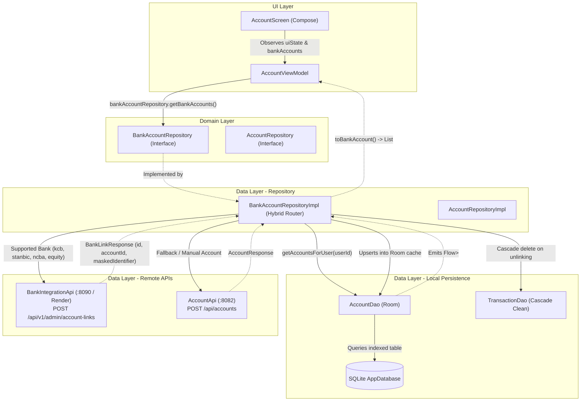
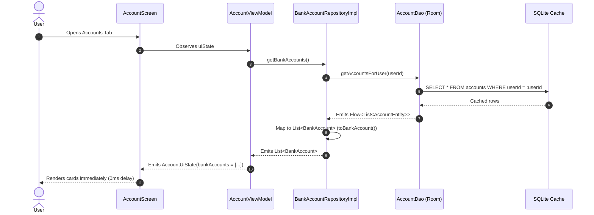
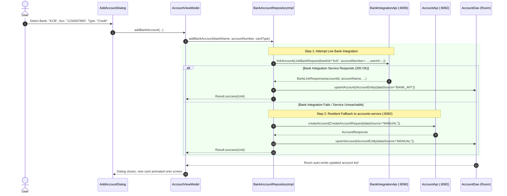
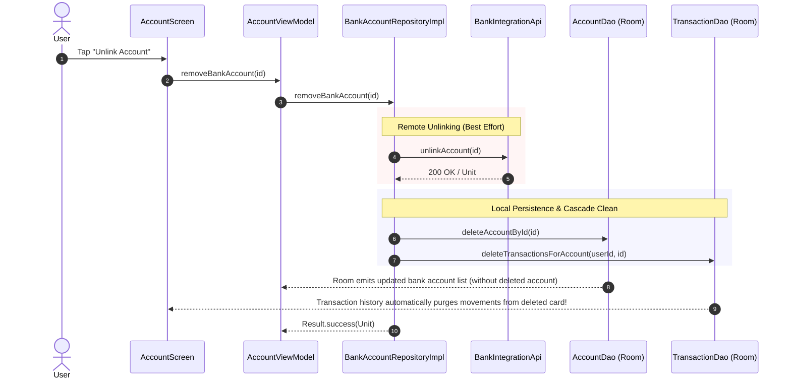

# 01. Accounts Architecture & End-to-End Data Flow

This document details the architectural layout, data pipelines, and request journeys of the **Account & Banking Integration System** in SmartMoney.

---

## 1. High-Level Architectural Flow

SmartMoney uses a **Hybrid Multi-Tier Banking Pipeline**. Supported Tier-1 financial institutions (KCB, Equity, NCBA, Stanbic) route through the dedicated **Bank Integration Service** (`:8090` or Render Cloud), while generic accounts fall back to the **Accounts Service** (`:8082`) and local Room persistence.



---

## 2. Core Request Journeys

### Journey 1: Viewing Linked Accounts & Freshness Guard



#### The 30-Second Freshness Guard
In [`AccountViewModel.kt`](file:///home/frank/AndroidStudioProjects/smartmoney/app/src/main/java/com/example/smartmoney/ui/accounts/AccountViewModel.kt#L64-L66):
```kotlin
private var lastSyncTimestamp: Long = 0L
private val SYNC_COOLDOWN_MS = 30_000L
```
When navigating between screens or app warmup, sync requests within 30 seconds of an existing sync are ignored. This prevents duplicate network roundtrips and avoids rate-limiting backend services.

---

### Journey 2: Linking a Real Bank Account (With Resilient Fallback)

When the user links an account (e.g. KCB or Equity), [`BankAccountRepositoryImpl.addBankAccount()`](file:///home/frank/AndroidStudioProjects/smartmoney/app/src/main/java/com/example/smartmoney/data/repository/BankAccountRepositoryImpl.kt#L77-L162) executes an intelligent two-tier handshake:



---

### Journey 3: Unlinking and Cascade Deletion

When an account is unlinked or removed:



* **Cascade Cleaning**: In [`BankAccountRepositoryImpl.kt`](file:///home/frank/AndroidStudioProjects/smartmoney/app/src/main/java/com/example/smartmoney/data/repository/BankAccountRepositoryImpl.kt#L251-L253), deleting an account triggers `transactionDao.deleteTransactionsForAccount(userId, id)`. This ensures that ghost transactions from deleted accounts never remain in the user's dashboard.

---

### Journey 4: Real-Time Balance Adjustment & Reconciliation

When simulated movements or debit transactions happen, the system updates account balances dynamically:

```kotlin
// BankAccountRepositoryImpl.kt (Line 265)
override suspend fun adjustBankBalance(
    bankName: String,
    delta: BigDecimal,
    accountId: String?,
    userId: String?
) = withContext(dispatchers.io) {
    val effectiveUserId = userId ?: userIdProvider()
    if (localDao != null) {
        if (!accountId.isNullOrBlank()) {
            localDao.adjustAccountBalance(effectiveUserId, accountId, delta)
        } else {
            localDao.adjustBankBalanceForUser(effectiveUserId, bankName, delta)
        }
    }
}
```
Room instantly computes the new balance and triggers recomposition on the account card!
