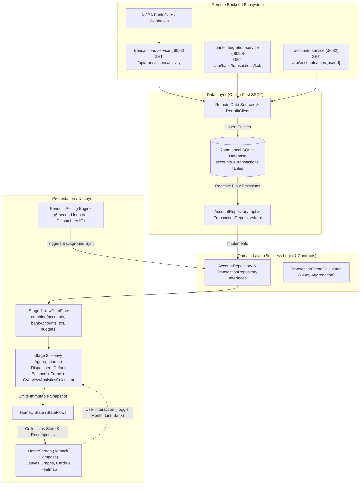
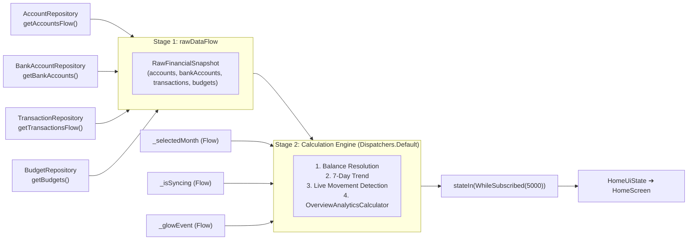
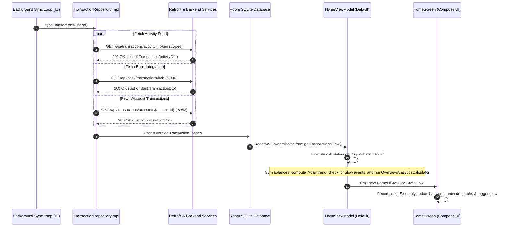

# 01. Home Architecture & End-to-End Data Flow

This document details how financial data flows across the SmartMoney application into the **Home / Overview Screen** (`HomeScreen`). It explains the offline-first Single Source of Truth (SSOT) architecture, the two-stage reactive aggregation pipeline, the autonomous background polling engine, and the thread scheduling model.

---

## 🏗️ High-Level Architectural Flow

SmartMoney follows **Clean Architecture** with a strictly **Unidirectional Data Flow (UDF)**. The UI never calls HTTP endpoints directly, and the UI never waits for network requests to complete before rendering.



---

## 🔄 The Offline-First Single Source of Truth (SSOT)

A core tenet of the SmartMoney architecture is that **the local Room SQLite database is the Single Source of Truth**:

1. **Zero Waiting for Network:** When the user navigates to the Home screen, the UI immediately loads and renders whatever financial data is stored in the local Room cache. There is zero blank-screen delay or blocking spinner.
2. **Decoupled Ingestion:** Network requests fetch fresh data in the background and insert/upsert records into Room. 
3. **Reactive Invalidation:** Room monitors table modifications. Whenever new rows are inserted or existing rows are updated, Room automatically emits the latest dataset through its `Flow<List<T>>` queries.
4. **Resilience to Network Drops:** If the device goes offline or backend microservices take time to spin up (e.g., Render free-tier cold starts), the Home screen continues to display the latest cached balances, cash flow charts, and analytics without crashing or throwing errors.

---

## ⚡ The Two-Stage Reactive Pipeline in `HomeViewModel`

Inside [`HomeViewModel.kt`](file:///home/frank/AndroidStudioProjects/smartmoney/app/src/main/java/com/example/smartmoney/ui/home/HomeViewModel.kt), four separate asynchronous domain streams are unified and computed in a two-stage reactive pipeline:



### Stage 1: Combining Raw Domain Streams (`rawDataFlow`)
Lines 79–86 in [`HomeViewModel.kt`](file:///home/frank/AndroidStudioProjects/smartmoney/app/src/main/java/com/example/smartmoney/ui/home/HomeViewModel.kt#L79-L86):
```kotlin
private val rawDataFlow = combine(
    accountRepository.getAccountsFlow(userId),
    bankAccountRepository.getBankAccounts(),
    transactionRepository.getTransactionsFlow(userId = userId),
    budgetsFlow
) { accounts, bankAccounts, transactions, budgets ->
    RawFinancialSnapshot(accounts, bankAccounts, transactions, budgets)
}
```
* Collects from four independent domain flows simultaneously.
* Whenever *any* of the four repositories emits a new list, `rawDataFlow` combines them into a unified, immutable `RawFinancialSnapshot`.

### Stage 2: Heavy Aggregation on `Dispatchers.Default` (`uiState`)
Lines 89–173 in [`HomeViewModel.kt`](file:///home/frank/AndroidStudioProjects/smartmoney/app/src/main/java/com/example/smartmoney/ui/home/HomeViewModel.kt#L89-L173):
```kotlin
val uiState: StateFlow<HomeUiState> = combine(
    rawDataFlow,
    _selectedMonth,
    _hasDismissedWelcomeSheet,
    _isSyncing,
    _glowEvent
) { snapshot, currentMonth, dismissedWelcome, syncing, glow ->
    // 1. Calculate Total Balance across accounts or fallback bank cards
    // 2. Compute 7-day Cash In / Cash Out trends
    // 3. Compare with lastKnownBalance & lastKnownTxIds to trigger live Neon Glow
    // 4. Run OverviewAnalyticsCalculator for the selected month
    HomeUiState(...)
}
.flowOn(dispatchers.default) // CPU-intensive math runs off the Main Thread
.stateIn(
    scope = viewModelScope,
    started = SharingStarted.WhileSubscribed(5_000),
    initialValue = HomeUiState.DEFAULT
)
```
* **Thread Safety:** `.flowOn(dispatchers.default)` ensures that heavy mathematical calculations (such as parsing timestamps, bucketing days, summing `BigDecimal` currencies, and generating bezier graph points) execute on background worker threads. The Main/UI thread is kept completely free to render 60/120 FPS animations.
* **Subscription Management:** `SharingStarted.WhileSubscribed(5_000)` keeps the state flow active as long as the Home screen is visible, with a 5-second grace period for configuration changes (such as device rotation).

---

## ⏱️ The Autonomous Background Sync Engine

The Home screen features continuous, real-time balance and transaction synchronization managed by [`HomeViewModel`](file:///home/frank/AndroidStudioProjects/smartmoney/app/src/main/java/com/example/smartmoney/ui/home/HomeViewModel.kt#L200-L214):

```kotlin
private fun startPeriodicSync() {
    viewModelScope.launch(dispatchers.io) {
        while (isActive) {
            delay(6_000)
            try {
                transactionRepository.syncTransactions(userId = userId)
                if (userId.isNotBlank()) {
                    accountRepository.syncAccounts(userId)
                }
            } catch (_: Exception) {
                // Gracefully tolerate temporary network errors
            }
        }
    }
}
```

### Characteristics of the Sync Engine:
1. **6-Second Cadence:** Polling runs every 6 seconds on `Dispatchers.IO`, ensuring that live incoming funds (such as mobile money transfers or bank webhooks) appear on the dashboard almost instantaneously.
2. **Non-Blocking Fault Tolerance:** Every network call is wrapped in a `try/catch` block. If a backend gateway is unreachable, the loop silently continues without crashing or disturbing the user experience.
3. **Cancellation Safety:** Because the loop is launched inside `viewModelScope` with `while (isActive)`, it automatically stops whenever the user logs out or the screen is torn down.

---

## 🚀 End-to-End Sequence of a Synchronization Cycle

The following sequence traces what happens during a single background sync cycle:


