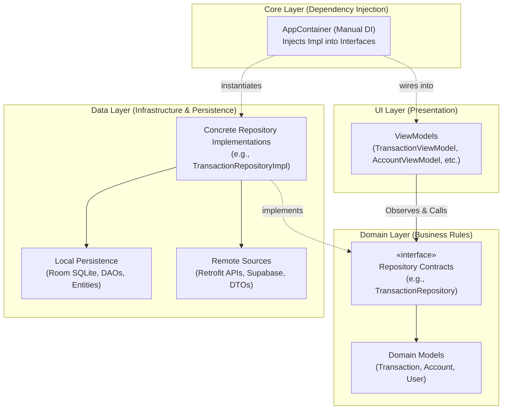

# 🔄 Repository x RepositoryImpl: Architecture & Complete Mapping Guide

Welcome to the **Repository x RepositoryImpl** deep-dive module. In modern Android Clean Architecture, the separation between a **Repository Interface** (in the Domain layer) and a **Repository Implementation** (in the Data layer) is the bedrock of testable, maintainable, and decoupled code.

This module provides a comprehensive, 1-to-1 mapping of every domain repository contract in SmartMoney to its underlying data layer implementation.

---

## 🏛️ Clean Architecture & The Dependency Inversion Principle

In SmartMoney, the application logic is divided into strict architectural boundaries:

### Why We Split Repository from RepositoryImpl

1. **Dependency Inversion (DIP)**: High-level UI and business rules depend on pure Kotlin abstractions (`interface`), never on concrete implementation details like Room SQLite or Retrofit HTTP clients.
2. **Framework Independence**: The domain layer contains zero Android dependencies, making business rules durable against library or OS changes.
3. **Unit Testability**: ViewModels can be tested in isolation using mock or fake repositories without initializing an Android SQLite database or spinning up mock servers.
4. **Single Source of Truth (SSOT)**: The implementation hides complex caching rules (e.g., offline-first Room cache, remote sync, error recovery) behind simple method calls.

---

## 🗺️ Repository Mapping Index

Click on any repository below to view its full method-by-method breakdown, sequence flows, threading rules, and codebase mappings:

| # | Repository Contract (Domain) | Implementation (Data) | Core Responsibilities |
| :-: | :--- | :--- | :--- |
| **01** | **[TransactionRepository](file:///home/frank/AndroidStudioProjects/smartmoney/kotlin%20education/repository%20x%20repositoryimpl/transaction/README.md)** | [`TransactionRepositoryImpl.kt`](file:///home/frank/AndroidStudioProjects/smartmoney/app/src/main/java/com/example/smartmoney/data/repository/TransactionRepositoryImpl.kt) | 3-tier sync (Activity feed, Bank integration, Remote DTOs), Room upserts, heads-up system notifications, and reactive user transaction streams. |
| **02** | **[AccountRepository](file:///home/frank/AndroidStudioProjects/smartmoney/kotlin%20education/repository%20x%20repositoryimpl/account/README.md)** | [`AccountRepositoryImpl.kt`](file:///home/frank/AndroidStudioProjects/smartmoney/app/src/main/java/com/example/smartmoney/data/repository/AccountRepositoryImpl.kt) | Accounts-service (`:8082`) orchestration, SQLite balance persistence, account creation, and cascade deletion. |
| **03** | **[BankAccountRepository](file:///home/frank/AndroidStudioProjects/smartmoney/kotlin%20education/repository%20x%20repositoryimpl/bank_account/README.md)** | [`BankAccountRepositoryImpl.kt`](file:///home/frank/AndroidStudioProjects/smartmoney/app/src/main/java/com/example/smartmoney/data/repository/BankAccountRepositoryImpl.kt) | Multi-bank linking (NCBA, Equity, KCB, Stanbic), dynamic user sessions, local balance simulation, and manual fallback syncing. |
| **04** | **[AuthRepository](file:///home/frank/AndroidStudioProjects/smartmoney/kotlin%20education/repository%20x%20repositoryimpl/auth/README.md)** | [`AuthRepositoryImpl.kt`](file:///home/frank/AndroidStudioProjects/smartmoney/app/src/main/java/com/example/smartmoney/data/repository/AuthRepositoryImpl.kt) | Sign in, Sign up, Token propagation to Retrofit interceptors, user session state, and per-user database switching. |
| **05** | **[BudgetRepository](file:///home/frank/AndroidStudioProjects/smartmoney/kotlin%20education/repository%20x%20repositoryimpl/budget/README.md)** | [`BudgetRepositoryImpl.kt`](file:///home/frank/AndroidStudioProjects/smartmoney/app/src/main/java/com/example/smartmoney/data/repository/BudgetRepositoryImpl.kt) | Category spending thresholds, monthly date range tracking, and stateful in-memory / persistent budget storage. |
| **06** | **[InvestmentRepository](file:///home/frank/AndroidStudioProjects/smartmoney/kotlin%20education/repository%20x%20repositoryimpl/investment/README.md)** | [`InvestmentRepositoryImpl.kt`](file:///home/frank/AndroidStudioProjects/smartmoney/app/src/main/java/com/example/smartmoney/data/repository/InvestmentRepositoryImpl.kt) | Portfolio holdings, return tracking, and asset allocation streams. |
| **07** | **[NotificationRepository](file:///home/frank/AndroidStudioProjects/smartmoney/kotlin%20education/repository%20x%20repositoryimpl/notification/README.md)** | [`NotificationRepositoryImpl.kt`](file:///home/frank/AndroidStudioProjects/smartmoney/app/src/main/java/com/example/smartmoney/data/repository/NotificationRepositoryImpl.kt) | In-app notification center, unread badge counter StateFlow, read receipts, and user notification isolation. |
| **08** | **[RahaRepository](file:///home/frank/AndroidStudioProjects/smartmoney/kotlin%20education/repository%20x%20repositoryimpl/raha/README.md)** | [`RahaRepositoryImpl.kt`](file:///home/frank/AndroidStudioProjects/smartmoney/app/src/main/java/com/example/smartmoney/data/repository/RahaRepositoryImpl.kt) | AI Financial Assistant chat pipeline, context-aware query dispatch, financial tool triggers, and conversation lifecycle. |
| **09** | **[UserRepository](file:///home/frank/AndroidStudioProjects/smartmoney/kotlin%20education/repository%20x%20repositoryimpl/user/README.md)** | [`UserRepositoryImpl.kt`](file:///home/frank/AndroidStudioProjects/smartmoney/app/src/main/java/com/example/smartmoney/data/repository/UserRepositoryImpl.kt) | User profile sync, avatar storage, and profile update mutations. |
| **10** | **[AccountConnectionRepository](file:///home/frank/AndroidStudioProjects/smartmoney/kotlin%20education/repository%20x%20repositoryimpl/account_connection/README.md)** | [`AccountConnectionRepositoryImpl.kt`](file:///home/frank/AndroidStudioProjects/smartmoney/app/src/main/java/com/example/smartmoney/data/repository/AccountConnectionRepositoryImpl.kt) | Open banking connection health, sync timestamps, and credential status monitoring. |

---

## ⚡ How to Navigate Each Folder

Each subfolder contains a dedicated `README.md` organized in the following uniform format:
1. **Overview & Responsibility**: What the repository manages in plain English.
2. **Contract vs. Implementation Links**: Exact file paths to both source files.
3. **Data Flow Sequence Diagram**: Visual flow of calls between UI, Domain, and Data layers.
4. **Method-by-Method Mapping**: Side-by-side analysis of every interface method and how `Impl` fulfills it (queries, endpoints, dispatchers, error handling).
5. **Dependency Injection Wiring**: Code snippet showing how [`AppContainer.kt`](file:///home/frank/AndroidStudioProjects/smartmoney/app/src/main/java/com/example/smartmoney/core/di/AppContainer.kt) wires it.
6. **Key Architecture Lessons**: Crucial Kotlin/Android patterns demonstrated in that repository.
