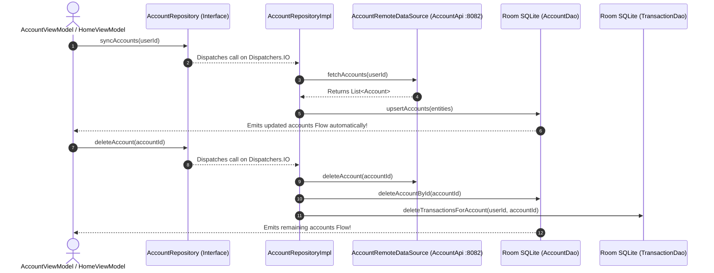

# 🏦 AccountRepository ⟷ AccountRepositoryImpl
### End-to-End Mapping & Architectural Deep Dive

This document details the mapping between the domain interface **[`AccountRepository`](file:///home/frank/AndroidStudioProjects/smartmoney/app/src/main/java/com/example/smartmoney/domain/repository/AccountRepository.kt)** and its concrete data-layer orchestrator **[`AccountRepositoryImpl`](file:///home/frank/AndroidStudioProjects/smartmoney/app/src/main/java/com/example/smartmoney/data/repository/AccountRepositoryImpl.kt)**.

---

## 1. 📂 File Locations

- **Domain Interface (Contract)**: [`app/src/main/java/com/example/smartmoney/domain/repository/AccountRepository.kt`](file:///home/frank/AndroidStudioProjects/smartmoney/app/src/main/java/com/example/smartmoney/domain/repository/AccountRepository.kt)
- **Data Implementation (Worker)**: [`app/src/main/java/com/example/smartmoney/data/repository/AccountRepositoryImpl.kt`](file:///home/frank/AndroidStudioProjects/smartmoney/app/src/main/java/com/example/smartmoney/data/repository/AccountRepositoryImpl.kt)

---

## 2. 🏛️ High-Level Architecture & Data Flow

`AccountRepositoryImpl` is the single source of truth for all bank and financial accounts registered in the backend `accounts-service` (`:8082`):
- It coordinates HTTP communication through [`AccountRemoteDataSource`](file:///home/frank/AndroidStudioProjects/smartmoney/app/src/main/java/com/example/smartmoney/data/remote/datasource/AccountRemoteDataSource.kt) wrapping `AccountApi`.
- It persists account snapshots in Room SQLite table `accounts` via [`AccountDao`](file:///home/frank/AndroidStudioProjects/smartmoney/app/src/main/java/com/example/smartmoney/data/local/dao/AccountDao.kt).
- It handles cascade deletion of local transactions when an account is unlinked.



---

## 3. 🔍 Method-by-Method Mapping

### Method 1: `getAccountsFlow`

#### Domain Contract:
```kotlin
fun getAccountsFlow(userId: String): Flow<List<Account>>
```

#### Implementation in `AccountRepositoryImpl`:
```kotlin
override fun getAccountsFlow(userId: String): Flow<List<Account>> {
    return localDao.getAccountsForUser(userId)
        .map { list -> list.map { it.toDomain() } }
        .flowOn(dispatchers.default)
}
```

#### Mapping Breakdown:
- **Room Reactivity**: Directly observes `localDao.getAccountsForUser(userId)`. When accounts are added, updated, or deleted, Room automatically re-queries SQLite and emits the new list.
- **Domain Mapping**: Converts database entities (`AccountEntity`) to clean domain models (`Account`) using `it.toDomain()`.
- **Dispatcher Offloading**: Uses `.flowOn(dispatchers.default)` to ensure entity mapping never blocks the Android UI frame thread.

---

### Method 2: `syncAccounts`

#### Domain Contract:
```kotlin
suspend fun syncAccounts(userId: String): Result<Unit>
```

#### Implementation in `AccountRepositoryImpl`:
```kotlin
override suspend fun syncAccounts(userId: String): Result<Unit> = withContext(dispatchers.io) {
    try {
        val domainAccounts = remoteDataSource.fetchAccounts(userId)
        val entities = domainAccounts.map { AccountEntity.fromDomain(it) }
        localDao.upsertAccounts(entities)
        Result.success(Unit)
    } catch (e: Exception) {
        Result.failure(e)
    }
}
```

#### Mapping Breakdown:
- **Single Synchronization Authority**: In SmartMoney's architecture audit (Finding F-02), this method was established as the *sole authoritative network fetch* for accounts, eliminating duplicate HTTP calls and SQLite lock contention.
- **Batch Upsert**: Converts remote accounts to entities and executes `localDao.upsertAccounts(entities)` in a single atomic SQLite transaction.
- **Error Encapsulation**: Returns Kotlin's `Result<Unit>` so callers can respond to network failures without uncaught crash exceptions.

---

### Method 3: `createAccount`

#### Domain Contract:
```kotlin
suspend fun createAccount(account: Account): Result<Account>
```

#### Implementation in `AccountRepositoryImpl`:
```kotlin
override suspend fun createAccount(account: Account): Result<Account> = withContext(dispatchers.io) {
    try {
        val request = CreateAccountRequest(
            userId = account.userId,
            providerAccountId = account.accountId,
            accountName = account.accountName,
            institution = account.institution,
            accountType = if (account.accountType.equals("CREDIT", ignoreCase = true)) "CREDIT" else "DEPOSIT",
            maskedIdentifier = account.maskedIdentifier ?: "**** ${account.accountId.takeLast(4)}",
            currency = account.currency,
            initialBalance = account.availableBalance,
            creditLimit = account.creditLimit ?: BigDecimal.ZERO,
            dataSource = account.dataSource
        )
        val domainAccount = remoteDataSource.createAccount(request)
        localDao.upsertAccount(AccountEntity.fromDomain(domainAccount))
        Result.success(domainAccount)
    } catch (e: Exception) {
        Result.failure(e)
    }
}
```

#### Mapping Breakdown:
- **Request DTO Construction**: Maps domain model attributes to `CreateAccountRequest`, masking sensitive numbers (`**** 1234`).
- **Immediate Cache Sync**: Immediately writes the server-confirmed account into SQLite (`localDao.upsertAccount`), keeping the local database instantly synchronized.

---

### Method 4: `deleteAccount`

#### Domain Contract:
```kotlin
suspend fun deleteAccount(id: String): Result<Unit>
```

#### Implementation in `AccountRepositoryImpl`:
```kotlin
override suspend fun deleteAccount(id: String): Result<Unit> = withContext(dispatchers.io) {
    try {
        remoteDataSource.deleteAccount(id)
        localDao.deleteAccountById(id)
        val currentUserId = userIdProvider?.invoke()
        if (!currentUserId.isNullOrBlank() && transactionDao != null) {
            transactionDao.deleteTransactionsForAccount(currentUserId, id)
        }
        Result.success(Unit)
    } catch (e: Exception) {
        Result.failure(e)
    }
}
```

#### Mapping Breakdown:
- **Remote & Local Deletion**: Deletes the account via HTTP endpoint and deletes the row from the `accounts` table in SQLite.
- **Cascade Cleanup**: Also deletes associated transactions in `TransactionDao` for that account to prevent orphan records or inaccurate spending graphs.

---

## 4. 🔌 Dependency Injection Wiring in `AppContainer`

In [`AppContainer.kt`](file:///home/frank/AndroidStudioProjects/smartmoney/app/src/main/java/com/example/smartmoney/core/di/AppContainer.kt):
```kotlin
override val accountRepository: AccountRepository by lazy {
    AccountRepositoryImpl(
        remoteDataSource = accountRemoteDataSource,
        localDao = database.accountDao(),
        transactionDao = database.transactionDao(),
        userIdProvider = { authRepository.currentUserId() }
    )
}
```

In [`MainActivity.kt`](file:///home/frank/AndroidStudioProjects/smartmoney/app/src/main/java/com/example/smartmoney/MainActivity.kt):
```kotlin
val accountViewModel: AccountViewModel = viewModel(
    key = "account_$currentUserId",
    factory = AccountViewModel.Factory(
        repository = appContainer.accountRepository,
        bankAccountRepository = appContainer.bankAccountRepository,
        userId = currentUserId,
        transactionRepository = appContainer.transactionRepository
    )
)
```

---

## 5. 💡 Key Architectural Lessons

1. **Elimination of Duplicate Schedulers**: Rather than both `AccountRepository` and `BankAccountRepository` polling backend endpoints simultaneously, `AccountRepository.syncAccounts()` is the single owner of account network synchronization.
2. **Cascade Integrity**: When an account is removed, the repository ensures local foreign data (e.g. transactions tied to that account) are purged in lockstep.
