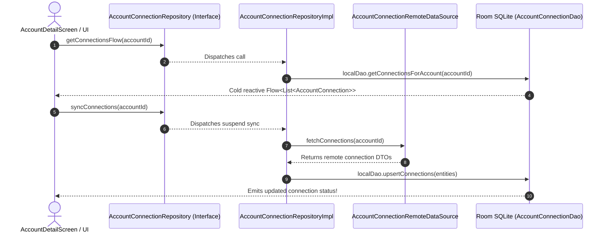

# 🔗 AccountConnectionRepository ⟷ AccountConnectionRepositoryImpl
### End-to-End Mapping & Architectural Deep Dive

This document details the mapping between the domain interface **[`AccountConnectionRepository`](file:///home/frank/AndroidStudioProjects/smartmoney/app/src/main/java/com/example/smartmoney/domain/repository/AccountConnectionRepository.kt)** and its concrete data-layer orchestrator **[`AccountConnectionRepositoryImpl`](file:///home/frank/AndroidStudioProjects/smartmoney/app/src/main/java/com/example/smartmoney/data/repository/AccountConnectionRepositoryImpl.kt)**.

---

## 1. 📂 File Locations

- **Domain Interface (Contract)**: [`app/src/main/java/com/example/smartmoney/domain/repository/AccountConnectionRepository.kt`](file:///home/frank/AndroidStudioProjects/smartmoney/app/src/main/java/com/example/smartmoney/domain/repository/AccountConnectionRepository.kt)
- **Data Implementation (Worker)**: [`app/src/main/java/com/example/smartmoney/data/repository/AccountConnectionRepositoryImpl.kt`](file:///home/frank/AndroidStudioProjects/smartmoney/app/src/main/java/com/example/smartmoney/data/repository/AccountConnectionRepositoryImpl.kt)

---

## 2. 🏛️ High-Level Architecture & Connection Health Flow

`AccountConnectionRepositoryImpl` monitors open banking connection health:
- Tracks provider connection statuses (`CONNECTED`, `EXPIRED`, `SYNCING`, `ERROR`).
- Persists sync timestamps and connection error logs in Room SQLite table `account_connections` via [`AccountConnectionDao`](file:///home/frank/AndroidStudioProjects/smartmoney/app/src/main/java/com/example/smartmoney/data/local/dao/AccountConnectionDao.kt).
- Coordinates with [`AccountConnectionRemoteDataSource`](file:///home/frank/AndroidStudioProjects/smartmoney/app/src/main/java/com/example/smartmoney/data/remote/datasource/AccountConnectionRemoteDataSource.kt) to refresh consent tokens.



---

## 3. 🔍 Method-by-Method Mapping

### Method 1: `getConnectionsFlow`

#### Domain Contract:
```kotlin
fun getConnectionsFlow(accountId: String): Flow<List<AccountConnection>>
```

#### Implementation in `AccountConnectionRepositoryImpl`:
```kotlin
override fun getConnectionsFlow(accountId: String): Flow<List<AccountConnection>> {
    return localDao.getConnectionsForAccount(accountId).map { list ->
        list.map { it.toDomain() }
    }
}
```

#### Mapping Breakdown:
- **Reactive Observation**: Streams real-time updates of connection health for a specific bank account.
- **Domain Mapping**: Translates SQLite `AccountConnectionEntity` rows to domain `AccountConnection` objects.

---

### Method 2: `syncConnections`

#### Domain Contract:
```kotlin
suspend fun syncConnections(accountId: String): Result<Unit>
```

#### Implementation in `AccountConnectionRepositoryImpl`:
```kotlin
override suspend fun syncConnections(accountId: String): Result<Unit> {
    return try {
        val remoteDtos = remoteDataSource.fetchConnections(accountId)
        val domainModels = remoteDtos.map { it.toDomain() }
        val entities = domainModels.map { AccountConnectionEntity.fromDomain(it) }
        localDao.upsertConnections(entities)
        Result.success(Unit)
    } catch (e: Exception) {
        Result.failure(e)
    }
}
```

#### Mapping Breakdown:
- **Clean 3-Stage Transformation**:
  `Remote DTO` ➔ `Domain Model` ➔ `Room Entity` ➔ `SQLite Upsert`.
- **Fault-Tolerant**: Network issues return `Result.failure(e)`, allowing the UI to show an inline retry button without crashing.

---

## 4. 💡 Key Architectural Lessons

1. **Separation of Concerns**: Keeping connection metadata and consent tokens in a distinct repository separates low-level banking session health from user financial ledger balances.
2. **Result Pattern**: Using `Result<Unit>` provides functional error handling (`result.onSuccess { }`, `result.onFailure { }`), eliminating messy `try/catch` boilerplate in ViewModels.
