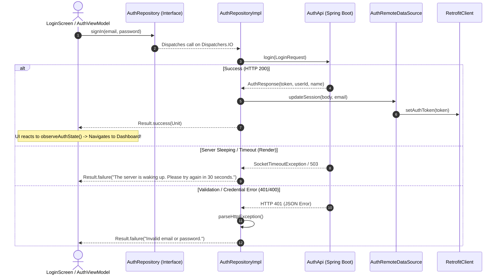

# 🔐 AuthRepository ⟷ AuthRepositoryImpl
### End-to-End Mapping & Architectural Deep Dive

This document details the mapping between the domain interface **[`AuthRepository`](file:///home/frank/AndroidStudioProjects/smartmoney/app/src/main/java/com/example/smartmoney/domain/repository/AuthRepository.kt)** and its concrete data-layer orchestrator **[`AuthRepositoryImpl`](file:///home/frank/AndroidStudioProjects/smartmoney/app/src/main/java/com/example/smartmoney/data/repository/AuthRepositoryImpl.kt)**.

---

## 1. 📂 File Locations

- **Domain Interface (Contract)**: [`app/src/main/java/com/example/smartmoney/domain/repository/AuthRepository.kt`](file:///home/frank/AndroidStudioProjects/smartmoney/app/src/main/java/com/example/smartmoney/domain/repository/AuthRepository.kt)
- **Data Implementation (Worker)**: [`app/src/main/java/com/example/smartmoney/data/repository/AuthRepositoryImpl.kt`](file:///home/frank/AndroidStudioProjects/smartmoney/app/src/main/java/com/example/smartmoney/data/repository/AuthRepositoryImpl.kt)

---

## 2. 🏛️ High-Level Architecture & Authentication Pipeline

`AuthRepositoryImpl` manages the complete user session lifecycle:
1. **Network Authentication**: Calls Spring Boot auth microservice endpoints (`POST /api/auth/register`, `POST /api/auth/login`) via Retrofit [`AuthApi`](file:///home/frank/AndroidStudioProjects/smartmoney/app/src/main/java/com/example/smartmoney/data/remote/api/AuthApi.kt).
2. **Session Persistence**: Updates [`AuthRemoteDataSource`](file:///home/frank/AndroidStudioProjects/smartmoney/app/src/main/java/com/example/smartmoney/data/remote/datasource/AuthRemoteDataSource.kt) with JWT Bearer tokens and user profile metadata.
3. **Token Propagation**: Transmits auth tokens into [`RetrofitClient`](file:///home/frank/AndroidStudioProjects/smartmoney/app/src/main/java/com/example/smartmoney/data/remote/RetrofitClient.kt), attaching `Authorization: Bearer <token>` to all downstream requests.
4. **Render Cold-Start & Error Parsing**: Gracefully detects server spin-ups (502/503/504/timeouts) and extracts detailed JSON validation errors.



---

## 3. 🔍 Method-by-Method Mapping

### Method 1: `signUp` & `signIn`

#### Domain Contract:
```kotlin
suspend fun signUp(name: String, email: String, password: String, phoneNumber: String? = null): Result<Unit>
suspend fun signIn(email: String, password: String): Result<Unit>
```

#### Implementation in `AuthRepositoryImpl`:
```kotlin
override suspend fun signIn(email: String, password: String): Result<Unit> = withContext(dispatchers.io) {
    try {
        val request = LoginRequest(email = email, password = password)
        val response = authApi.login(request)
        if (!response.isSuccessful) {
            throw HttpException(response)
        }
        val body = response.body() ?: AuthResponse()
        remoteDataSource.updateSession(body = body, email = email, fallbackName = null)
        Result.success(Unit)
    } catch (e: SocketTimeoutException) {
        Result.failure(Exception("The server is waking up. Please try again in 30 seconds."))
    } catch (e: HttpException) {
        val mappedMessage = parseHttpException(e)
        Result.failure(Exception(mappedMessage))
    } catch (e: IOException) {
        Result.failure(Exception("Network error occurred. Please check your internet connection and try again."))
    } catch (e: Exception) {
        Result.failure(Exception(e.localizedMessage ?: "An unexpected error occurred."))
    }
}
```

#### Mapping Breakdown:
- **Comprehensive Error Categorization**: Converts low-level network exceptions (`SocketTimeoutException`, `IOException`, `HttpException`) into user-friendly localized messages.
- **Session Mutation**: `remoteDataSource.updateSession` updates in-memory tokens and persistent preferences, automatically unlocking the authenticated state.

---

### Method 2: `signOut`

#### Domain Contract:
```kotlin
suspend fun signOut(): Result<Unit>
```

#### Implementation in `AuthRepositoryImpl`:
```kotlin
override suspend fun signOut(): Result<Unit> = withContext(dispatchers.io) {
    remoteDataSource.signOut()
}
```

#### Mapping Breakdown:
- Clears the in-memory JWT token.
- Resets `RetrofitClient.setAuthToken(null)`.
- Wipes active user profile state in `UserProfileManager`.

---

### Methods 3–6: Synchronous Session Getters & Reactive State

#### Domain Contract:
```kotlin
fun currentUserId(): String?
fun currentUserName(): String?
fun currentUserEmail(): String?
fun currentUserPhoneNumber(): String?
fun isUserLoggedIn(): Boolean
fun observeAuthState(): Flow<Boolean>
```

#### Implementation in `AuthRepositoryImpl`:
```kotlin
override fun currentUserId(): String? = remoteDataSource.currentUserId()
override fun currentUserName(): String? = remoteDataSource.currentUserName()
override fun currentUserEmail(): String? = remoteDataSource.currentUserEmail()
override fun currentUserPhoneNumber(): String? = remoteDataSource.currentUserPhoneNumber()
override fun isUserLoggedIn(): Boolean = remoteDataSource.isUserLoggedIn()
override fun observeAuthState(): Flow<Boolean> = remoteDataSource.observeAuthState()
```

#### Mapping Breakdown:
- **Instant Non-Blocking Reads**: Allows ViewModels and `AppContainer` to access the current session identity synchronously without suspending.
- **Reactive UI Flow**: `observeAuthState()` emits a Boolean whenever the session changes, driving instant screen transitions between Auth and Dashboard in `MainActivity`.

---

## 4. 🔌 Dependency Injection Wiring in `AppContainer`

In [`AppContainer.kt`](file:///home/frank/AndroidStudioProjects/smartmoney/app/src/main/java/com/example/smartmoney/core/di/AppContainer.kt):
```kotlin
override val authRepository: AuthRepository by lazy {
    AuthRepositoryImpl(
        remoteDataSource = authRemoteDataSource
    )
}
```

In [`MainActivity.kt`](file:///home/frank/AndroidStudioProjects/smartmoney/app/src/main/java/com/example/smartmoney/MainActivity.kt):
```kotlin
val authViewModel: AuthViewModel = viewModel(
    factory = AuthViewModel.Factory(appContainer.authRepository)
)
```

---

## 5. 💡 Key Architectural Lessons

1. **Decoupling Auth Provider**: Notice that the UI layer and ViewModels have zero imports of Supabase, Spring Boot, or Retrofit. If authentication is switched to Firebase or OAuth2, only `AuthRepositoryImpl` changes.
2. **Resilience to Cloud Cold-Starts**: By catching `SocketTimeoutException` and HTTP 502/503/504, the repository prevents frustrating generic crashes when free-tier backend services (like Render) wake from sleep.
