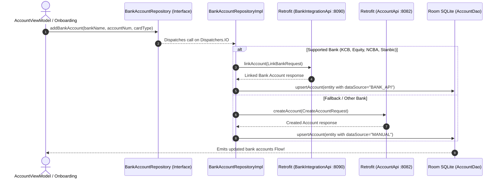

# 💳 BankAccountRepository ⟷ BankAccountRepositoryImpl
### End-to-End Mapping & Architectural Deep Dive

This document details the mapping between the domain interface **[`BankAccountRepository`](file:///home/frank/AndroidStudioProjects/smartmoney/app/src/main/java/com/example/smartmoney/domain/repository/BankAccountRepository.kt)** and its concrete data-layer orchestrator **[`BankAccountRepositoryImpl`](file:///home/frank/AndroidStudioProjects/smartmoney/app/src/main/java/com/example/smartmoney/data/repository/BankAccountRepositoryImpl.kt)**.

---

## 1. 📂 File Locations

- **Domain Interface (Contract)**: [`app/src/main/java/com/example/smartmoney/domain/repository/BankAccountRepository.kt`](file:///home/frank/AndroidStudioProjects/smartmoney/app/src/main/java/com/example/smartmoney/domain/repository/BankAccountRepository.kt)
- **Data Implementation (Worker)**: [`app/src/main/java/com/example/smartmoney/data/repository/BankAccountRepositoryImpl.kt`](file:///home/frank/AndroidStudioProjects/smartmoney/app/src/main/java/com/example/smartmoney/data/repository/BankAccountRepositoryImpl.kt)

---

## 2. 🏛️ High-Level Architecture & Banking Integration Flow

`BankAccountRepositoryImpl` is a **hybrid banking orchestrator**:
1. **Open Banking Service (`:8090` / Render)**: For supported banks (KCB, Equity, NCBA, Stanbic), it attempts direct integration handshake via `RetrofitClient.bankIntegrationApi.linkAccount(...)`.
2. **Accounts Service Fallback (`:8082`)**: If the bank service is offline or for generic institutions, it falls back to manual account creation via `AccountRemoteDataSource`.
3. **Local Simulation & Balance Tweaks**: Exposes methods to simulate credits/debits directly in the local SQLite cache without waiting for external webhooks.



---

## 3. 🔍 Method-by-Method Mapping

### Method 1: `getBankAccounts`

#### Domain Contract:
```kotlin
fun getBankAccounts(): Flow<List<BankAccount>>
```

#### Implementation in `BankAccountRepositoryImpl`:
```kotlin
override fun getBankAccounts(): Flow<List<BankAccount>> {
    val currentUserId = userIdProvider()
    return if (localDao != null) {
        localDao.getAccountsForUser(currentUserId).map { list ->
            list.map { it.toBankAccount() }
        }.flowOn(dispatchers.default)
    } else {
        _bankAccountsFlow.asStateFlow()
    }
}
```

#### Mapping Breakdown:
- **Reactive Stream**: Observes `localDao.getAccountsForUser(currentUserId)`.
- **Domain Projection**: Maps general `AccountEntity` rows to specialized `BankAccount` presentation models (`id`, `bankName`, `accountNumber`, `cardType`, `balance`).
- **Memory Fallback**: If initialized without Room (e.g. preview mode), it falls back to `_bankAccountsFlow.asStateFlow()`.

---

### Method 2: `addBankAccount`

#### Domain Contract:
```kotlin
suspend fun addBankAccount(
    bankName: String,
    accountNumber: String,
    cardType: String
): Result<Unit>
```

#### Implementation in `BankAccountRepositoryImpl`:
```kotlin
override suspend fun addBankAccount(
    bankName: String,
    accountNumber: String,
    cardType: String
): Result<Unit> = withContext(dispatchers.io) {
    // 1. If supported bank (KCB, Stanbic, NCBA, Equity), link via bank-integration-service
    val bankKey = bankName.trim().lowercase()
    if (bankKey in listOf("kcb", "stanbic", "ncba", "equity")) {
        val linkReq = LinkBankRequest(...)
        val response = RetrofitClient.bankIntegrationApi.linkAccount(linkReq)
        if (response.isSuccessful) {
            localDao.upsertAccount(entity)
            return@withContext Result.success(Unit)
        }
    }

    // 2. Fallback to direct accounts-service creation
    val request = CreateAccountRequest(...)
    val created = remoteDataSource.createAccount(request)
    localDao.upsertAccount(entity)
    Result.success(Unit)
}
```

#### Mapping Breakdown:
- **Two-Tier Strategy**: Gracefully handles bank API connectivity. If the integration service fails or is sleeping on Render, it automatically falls back to standard account creation.
- **Masking**: Automatically formats the account number into a secure masked identifier (`**** 1234`).
- **UUID Normalization**: Ensures UUID hashing compatibility across different backend formats (`UUID.nameUUIDFromBytes`).

---

### Method 3: `removeBankAccount`

#### Domain Contract:
```kotlin
suspend fun removeBankAccount(id: String): Result<Unit>
```

#### Implementation in `BankAccountRepositoryImpl`:
```kotlin
override suspend fun removeBankAccount(id: String): Result<Unit> = withContext(dispatchers.io) {
    try {
        // 1. Try unlinking via bank-integration-service
        RetrofitClient.bankIntegrationApi.unlinkAccount(...)

        // 2. Fallback delete from accounts-service
        remoteDataSource.deleteAccount(id)

        // 3. Purge locally from Room and delete associated transactions
        localDao.deleteAccountById(id)
        transactionDao.deleteTransactionsForAccount(effectiveUserId, id)
        Result.success(Unit)
    } catch (e: Exception) {
        Result.failure(e)
    }
}
```

#### Mapping Breakdown:
- **Best-Effort Remote Cleanup**: Attempts unlinking on both backend microservices.
- **Strict Local Cleanup**: Regardless of network status, immediately deletes the account from SQLite and clears orphaned transactions from `TransactionDao`.

---

### Method 4: `adjustKcbBalance` & `adjustBankBalance`

#### Domain Contract:
```kotlin
suspend fun adjustKcbBalance(delta: BigDecimal)
suspend fun adjustBankBalance(bankName: String, delta: BigDecimal, accountId: String? = null, userId: String? = null)
```

#### Implementation in `BankAccountRepositoryImpl`:
```kotlin
override suspend fun adjustKcbBalance(delta: BigDecimal) = withContext(dispatchers.io) {
    adjustBankBalance("KCB", delta)
}

override suspend fun adjustBankBalance(
    bankName: String,
    delta: BigDecimal,
    accountId: String?,
    userId: String?
) = withContext(dispatchers.io) {
    val effectiveUserId = userId ?: userIdProvider()
    if (localDao != null) {
        if (!accountId.isNullOrBlank()) {
            localDao.adjustAccountBalance(effectiveUserId, accountId, delta)
        } else {
            localDao.adjustBankBalanceForUser(effectiveUserId, bankName, delta)
        }
    }
}
```

#### Mapping Breakdown:
- **Finding F-02/F-03 Remediation**: Promoted from an internal helper to the domain interface, removing unsafe type casting (`(bankAccountRepository as? BankAccountRepositoryImpl)`) in ViewModels.
- **Atomic SQLite Balance Adjustment**: Executes an atomic SQL `UPDATE accounts SET available_balance = available_balance + :delta WHERE ...`, preventing race conditions during simulated money movements.

---

## 4. 🔌 Dependency Injection Wiring in `AppContainer`

In [`AppContainer.kt`](file:///home/frank/AndroidStudioProjects/smartmoney/app/src/main/java/com/example/smartmoney/core/di/AppContainer.kt):
```kotlin
override val bankAccountRepository: BankAccountRepository by lazy {
    BankAccountRepositoryImpl(
        remoteDataSource = accountRemoteDataSource,
        localDao = database.accountDao(),
        transactionDao = database.transactionDao(),
        userIdProvider = { authRepository.currentUserId() ?: "default-user" }
    )
}
```

---

## 5. 💡 Key Architectural Lessons

1. **Promoting Interface Contracts**: Domain operations (like balance simulations) should be declared on the domain interface, never invoked through unsafe downcasts (`as? Impl`).
2. **Dynamic Lambda Scoping**: Using `userIdProvider = { authRepository.currentUserId() }` enables the repository to remain an application singleton while dynamically serving the active logged-in user.
