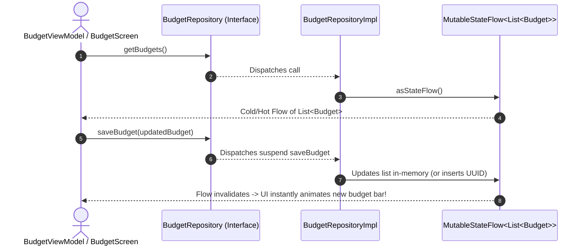

# 📊 BudgetRepository ⟷ BudgetRepositoryImpl
### End-to-End Mapping & Architectural Deep Dive

This document details the mapping between the domain interface **[`BudgetRepository`](file:///home/frank/AndroidStudioProjects/smartmoney/app/src/main/java/com/example/smartmoney/domain/repository/BudgetRepository.kt)** and its concrete data-layer orchestrator **[`BudgetRepositoryImpl`](file:///home/frank/AndroidStudioProjects/smartmoney/app/src/main/java/com/example/smartmoney/data/repository/BudgetRepositoryImpl.kt)**.

---

## 1. 📂 File Locations

- **Domain Interface (Contract)**: [`app/src/main/java/com/example/smartmoney/domain/repository/BudgetRepository.kt`](file:///home/frank/AndroidStudioProjects/smartmoney/app/src/main/java/com/example/smartmoney/domain/repository/BudgetRepository.kt)
- **Data Implementation (Worker)**: [`app/src/main/java/com/example/smartmoney/data/repository/BudgetRepositoryImpl.kt`](file:///home/frank/AndroidStudioProjects/smartmoney/app/src/main/java/com/example/smartmoney/data/repository/BudgetRepositoryImpl.kt)

---

## 2. 🏛️ High-Level Architecture & Budget Flow

`BudgetRepositoryImpl` provides reactive, stateful budget management:
- Maintains a reactive stream of category budgets (`Groceries`, `Utilities & Power`, `Shopping`, `Dining & Leisure`).
- Dynamically assigns monthly temporal boundaries (`startOfMonth` to `endOfMonth`) using Java Time `TemporalAdjusters`.
- Computes warning thresholds (`threshold: Int`, e.g. 80%) to alert users before they exceed category allocations.



---

## 3. 🔍 Method-by-Method Mapping

### Method 1: `getBudgets`

#### Domain Contract:
```kotlin
fun getBudgets(): Flow<List<Budget>>
```

#### Implementation in `BudgetRepositoryImpl`:
```kotlin
override fun getBudgets(): Flow<List<Budget>> = _budgetsFlow.asStateFlow()
```

#### Mapping Breakdown:
- **Read-Only StateFlow**: Exposes an unmodifiable `asStateFlow()` to consumers, preventing external code from tampering with the internal mutable state.
- **Initial Baseline Data**: Pre-populated with realistic household budgets (KES 35,000 for Groceries, KES 12,000 for Utilities), ensuring new users see an immediate functional preview.

---

### Method 2: `saveBudget`

#### Domain Contract:
```kotlin
suspend fun saveBudget(budget: Budget): Result<Unit>
```

#### Implementation in `BudgetRepositoryImpl`:
```kotlin
override suspend fun saveBudget(budget: Budget): Result<Unit> {
    val currentList = _budgetsFlow.value.toMutableList()
    val index = currentList.indexOfFirst { it.id == budget.id }
    if (index >= 0) {
        currentList[index] = budget
    } else {
        val newBudget = if (budget.id.isBlank()) {
            budget.copy(id = UUID.randomUUID().toString())
        } else budget
        currentList.add(0, newBudget)
    }
    _budgetsFlow.value = currentList
    return Result.success(Unit)
}
```

#### Mapping Breakdown:
- **Upsert Semantics**: If the budget ID already exists, it updates the existing entry in place; if new or blank, it generates a unique UUID (`UUID.randomUUID()`) and prepends it to the top.
- **Immutability Protection**: Clones the existing list (`toMutableList()`), mutates the copy, and assigns a brand-new immutable list instance to `_budgetsFlow.value`, guaranteeing proper Compose recomposition.

---

### Method 3: `deleteBudget`

#### Domain Contract:
```kotlin
suspend fun deleteBudget(id: String): Result<Unit>
```

#### Implementation in `BudgetRepositoryImpl`:
```kotlin
override suspend fun deleteBudget(id: String): Result<Unit> {
    val updated = _budgetsFlow.value.filter { it.id != id }
    _budgetsFlow.value = updated
    return Result.success(Unit)
}
```

#### Mapping Breakdown:
- **Filter-Based Deletion**: Filters out the target item by ID and emits the updated collection through the StateFlow.

---

## 4. 🔌 Dependency Injection Wiring in `AppContainer`

In [`AppContainer.kt`](file:///home/frank/AndroidStudioProjects/smartmoney/app/src/main/java/com/example/smartmoney/core/di/AppContainer.kt):
```kotlin
override val budgetRepository: BudgetRepository by lazy {
    BudgetRepositoryImpl()
}
```

In [`MainActivity.kt`](file:///home/frank/AndroidStudioProjects/smartmoney/app/src/main/java/com/example/smartmoney/MainActivity.kt):
```kotlin
val budgetViewModel: BudgetViewModel = viewModel(
    key = "budget_$currentUserId",
    factory = BudgetViewModel.Factory(
        budgetRepository = appContainer.budgetRepository,
        transactionRepository = appContainer.transactionRepository,
        userId = currentUserId
    )
)
```

---

## 5. 💡 Key Architectural Lessons

1. **StateFlow as a Reactive In-Memory Store**: A repository does not always need an immediate SQL database. A `MutableStateFlow` provides full reactive capabilities during prototyping, easily swappable with Room later without altering the domain interface.
2. **Minor Units for Financial Currency**: Notice that amounts are stored in minor units (`allocatedMinor: Long`, e.g. `3500000L` for KES 35,000.00), preventing floating-point rounding inaccuracies.
