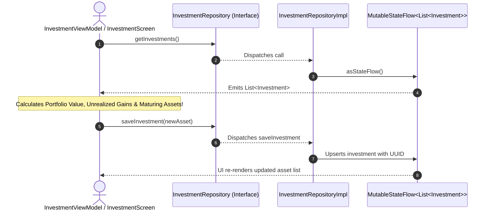

# 📈 InvestmentRepository ⟷ InvestmentRepositoryImpl
### End-to-End Mapping & Architectural Deep Dive

This document details the mapping between the domain interface **[`InvestmentRepository`](file:///home/frank/AndroidStudioProjects/smartmoney/app/src/main/java/com/example/smartmoney/domain/repository/InvestmentRepository.kt)** and its concrete data-layer orchestrator **[`InvestmentRepositoryImpl`](file:///home/frank/AndroidStudioProjects/smartmoney/app/src/main/java/com/example/smartmoney/data/repository/InvestmentRepositoryImpl.kt)**.

---

## 1. 📂 File Locations

- **Domain Interface (Contract)**: [`app/src/main/java/com/example/smartmoney/domain/repository/InvestmentRepository.kt`](file:///home/frank/AndroidStudioProjects/smartmoney/app/src/main/java/com/example/smartmoney/domain/repository/InvestmentRepository.kt)
- **Data Implementation (Worker)**: [`app/src/main/java/com/example/smartmoney/data/repository/InvestmentRepositoryImpl.kt`](file:///home/frank/AndroidStudioProjects/smartmoney/app/src/main/java/com/example/smartmoney/data/repository/InvestmentRepositoryImpl.kt)

---

## 2. 🏛️ High-Level Architecture & Investment Portfolio Flow

`InvestmentRepositoryImpl` manages asset portfolios across key asset classes in Kenya:
- **Money Market Funds (MMF)**: Highly liquid, daily compounded yield (e.g. Sanlam MMF).
- **Treasury Bills (T-Bills)**: Short-term government securities with explicit maturity tracking (e.g. CBK 91-Day T-Bill).
- **Fixed Deposits**: Bank-held fixed-term interest deposits (e.g. Stanbic 6-Month Deposit).



---

## 3. 🔍 Method-by-Method Mapping

### Method 1: `getInvestments`

#### Domain Contract:
```kotlin
fun getInvestments(): Flow<List<Investment>>
```

#### Implementation in `InvestmentRepositoryImpl`:
```kotlin
override fun getInvestments(): Flow<List<Investment>> = _investmentsFlow.asStateFlow()
```

#### Mapping Breakdown:
- Exposes `Flow<List<Investment>>` preloaded with realistic portfolio assets (Sanlam MMF, CBK T-Bill, Stanbic Fixed Deposit).
- Contains both `principalMinor` (invested capital) and `currentValueMinor` (current valuation), allowing downstream ViewModels to compute performance yields.

---

### Method 2: `saveInvestment`

#### Domain Contract:
```kotlin
suspend fun saveInvestment(investment: Investment): Result<Unit>
```

#### Implementation in `InvestmentRepositoryImpl`:
```kotlin
override suspend fun saveInvestment(investment: Investment): Result<Unit> {
    val currentList = _investmentsFlow.value.toMutableList()
    val index = currentList.indexOfFirst { it.id == investment.id }
    if (index >= 0) {
        currentList[index] = investment
    } else {
        val newInv = if (investment.id.isBlank()) {
            investment.copy(id = UUID.randomUUID().toString())
        } else investment
        currentList.add(0, newInv)
    }
    _investmentsFlow.value = currentList
    return Result.success(Unit)
}
```

#### Mapping Breakdown:
- Performs atomic collection mutation, assigning random UUIDs to newly added holdings.
- Re-emits an immutable copy to notify UI observers.

---

### Method 3: `deleteInvestment`

#### Domain Contract:
```kotlin
suspend fun deleteInvestment(id: String): Result<Unit>
```

#### Implementation in `InvestmentRepositoryImpl`:
```kotlin
override suspend fun deleteInvestment(id: String): Result<Unit> {
    val updated = _investmentsFlow.value.filter { it.id != id }
    _investmentsFlow.value = updated
    return Result.success(Unit)
}
```

#### Mapping Breakdown:
- Filters out the target holding and updates the StateFlow stream.

---

## 4. 🔌 Dependency Injection Wiring in `AppContainer`

In [`AppContainer.kt`](file:///home/frank/AndroidStudioProjects/smartmoney/app/src/main/java/com/example/smartmoney/core/di/AppContainer.kt):
```kotlin
override val investmentRepository: InvestmentRepository by lazy {
    InvestmentRepositoryImpl()
}
```

In [`MainActivity.kt`](file:///home/frank/AndroidStudioProjects/smartmoney/app/src/main/java/com/example/smartmoney/MainActivity.kt):
```kotlin
val investmentViewModel: InvestmentViewModel = viewModel(
    key = "investment_$currentUserId",
    factory = InvestmentViewModel.Factory(appContainer.investmentRepository)
)
```

---

## 5. 💡 Key Architectural Lessons

1. **Domain Enums in Models**: The model uses a domain-level enum `InvestmentType` (`MONEY_MARKET`, `TREASURY_BILL`, `FIXED_DEPOSIT`), enabling compiler-verified `when` statements in Compose UI.
2. **Date Boundaries & Maturity Alerts**: Tracking `valuationDate` and nullable `maturityDate` empowers the UI to highlight assets maturing within 90 days.
