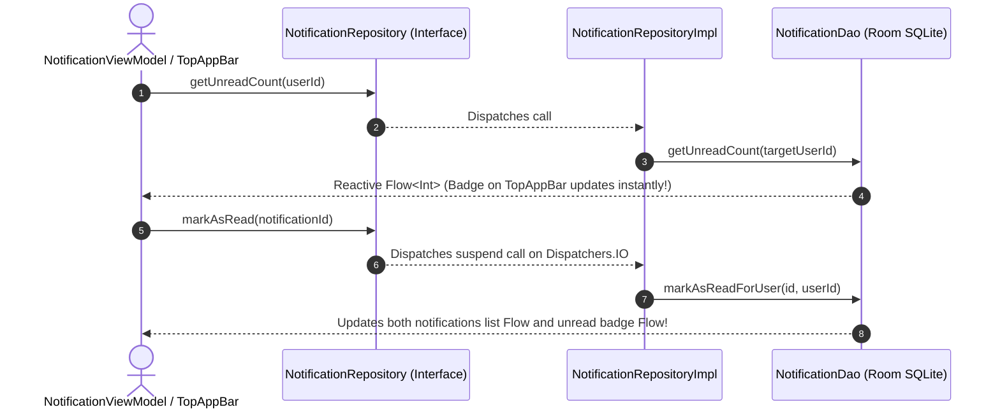

# 🔔 NotificationRepository ⟷ NotificationRepositoryImpl
### End-to-End Mapping & Architectural Deep Dive

This document details the mapping between the domain interface **[`NotificationRepository`](file:///home/frank/AndroidStudioProjects/smartmoney/app/src/main/java/com/example/smartmoney/domain/repository/NotificationRepository.kt)** and its concrete data-layer orchestrator **[`NotificationRepositoryImpl`](file:///home/frank/AndroidStudioProjects/smartmoney/app/src/main/java/com/example/smartmoney/data/repository/NotificationRepositoryImpl.kt)**.

---

## 1. 📂 File Locations

- **Domain Interface (Contract)**: [`app/src/main/java/com/example/smartmoney/domain/repository/NotificationRepository.kt`](file:///home/frank/AndroidStudioProjects/smartmoney/app/src/main/java/com/example/smartmoney/domain/repository/NotificationRepository.kt)
- **Data Implementation (Worker)**: [`app/src/main/java/com/example/smartmoney/data/repository/NotificationRepositoryImpl.kt`](file:///home/frank/AndroidStudioProjects/smartmoney/app/src/main/java/com/example/smartmoney/data/repository/NotificationRepositoryImpl.kt)

---

## 2. 🏛️ High-Level Architecture & Notification Flow

`NotificationRepositoryImpl` powers the application's in-app notification center:
- Backed by Room SQLite table `notifications` via [`NotificationDao`](file:///home/frank/AndroidStudioProjects/smartmoney/app/src/main/java/com/example/smartmoney/data/local/dao/NotificationDao.kt).
- Strictly enforces multi-user data isolation (User A never sees banking notifications belonging to User B).
- Exposes a dedicated reactive stream for the top bar unread badge counter (`getUnreadCount()`).



---

## 3. 🔍 Method-by-Method Mapping

### Method 1: `getNotifications` & `getUnreadCount`

#### Domain Contract:
```kotlin
fun getNotifications(userId: String? = null): Flow<List<Notification>>
fun getUnreadCount(userId: String? = null): Flow<Int>
```

#### Implementation in `NotificationRepositoryImpl`:
```kotlin
override fun getNotifications(userId: String?): Flow<List<Notification>> {
    val targetUserId = userId ?: userIdProvider?.invoke()
    val flow = if (!targetUserId.isNullOrBlank()) {
        notificationDao.getNotificationsForUser(targetUserId)
    } else {
        notificationDao.getAllNotifications()
    }
    return flow.map { list -> list.map { it.toDomain() } }
        .flowOn(dispatchers.default)
}

override fun getUnreadCount(userId: String?): Flow<Int> {
    val targetUserId = userId ?: userIdProvider?.invoke()
    val flow = if (!targetUserId.isNullOrBlank()) {
        notificationDao.getUnreadCount(targetUserId)
    } else {
        notificationDao.getUnreadCount()
    }
    return flow.flowOn(dispatchers.default)
}
```

#### Mapping Breakdown:
- **Reactive Stream Optimization**: `getUnreadCount` executes a lightweight `SELECT COUNT(*) WHERE is_read = 0 AND user_id = :userId` query, driving the bell badge without loading full notification bodies into memory.
- **Domain Transformation**: Maps `NotificationEntity` rows to pure `Notification` models on `Dispatchers.Default`.

---

### Methods 2–5: Read States & Clearing Actions

#### Domain Contract:
```kotlin
suspend fun insertNotification(notification: Notification, userId: String? = null)
suspend fun markAsRead(id: String, userId: String? = null)
suspend fun markAllAsRead(userId: String? = null)
suspend fun deleteNotification(id: String, userId: String? = null)
suspend fun clearAll(userId: String? = null)
```

#### Implementation in `NotificationRepositoryImpl`:
```kotlin
override suspend fun markAsRead(id: String, userId: String?) = withContext(dispatchers.io) {
    val targetUserId = userId ?: userIdProvider?.invoke()
    if (!targetUserId.isNullOrBlank()) {
        notificationDao.markAsReadForUser(id, targetUserId)
    } else {
        notificationDao.markAsRead(id)
    }
}

override suspend fun markAllAsRead(userId: String?) = withContext(dispatchers.io) {
    val targetUserId = userId ?: userIdProvider?.invoke()
    if (!targetUserId.isNullOrBlank()) {
        notificationDao.markAllAsReadForUser(targetUserId)
    } else {
        notificationDao.markAllAsRead()
    }
}
```

#### Mapping Breakdown:
- **User-Scoped Queries**: Every database update query includes `WHERE user_id = :userId` to prevent a user action from mutating another user's alert status on shared test devices.
- **Background Execution**: Always executes on `withContext(dispatchers.io)`.

---

## 4. 🔌 Dependency Injection Wiring in `AppContainer`

In [`AppContainer.kt`](file:///home/frank/AndroidStudioProjects/smartmoney/app/src/main/java/com/example/smartmoney/core/di/AppContainer.kt):
```kotlin
override val notificationRepository: NotificationRepository by lazy {
    NotificationRepositoryImpl(
        notificationDao = database.notificationDao(),
        userIdProvider = { authRepository.currentUserId() }
    )
}
```

In [`MainActivity.kt`](file:///home/frank/AndroidStudioProjects/smartmoney/app/src/main/java/com/example/smartmoney/MainActivity.kt):
```kotlin
val notificationViewModel: NotificationViewModel = viewModel(
    key = "notification_$currentUserId",
    factory = NotificationViewModel.Factory(
        repository = appContainer.notificationRepository,
        userId = currentUserId
    )
)
```

---

## 5. 💡 Key Architectural Lessons

1. **Lightweight Badge Observers**: Separating `getUnreadCount()` from `getNotifications()` avoids wastefully fetching large lists when all the top navigation bar needs is an integer count.
2. **Multi-User Data Sanitation**: Scoping Room updates with `userId` ensures strict tenant isolation in local SQLite.
