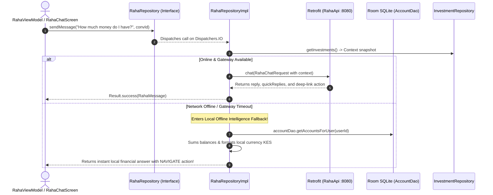

# 🤖 RahaRepository ⟷ RahaRepositoryImpl
### End-to-End Mapping & Architectural Deep Dive

This document details the mapping between the domain interface **[`RahaRepository`](file:///home/frank/AndroidStudioProjects/smartmoney/app/src/main/java/com/example/smartmoney/domain/repository/RahaRepository.kt)** and its concrete data-layer orchestrator **[`RahaRepositoryImpl`](file:///home/frank/AndroidStudioProjects/smartmoney/app/src/main/java/com/example/smartmoney/data/repository/RahaRepositoryImpl.kt)**.

---

## 1. 📂 File Locations

- **Domain Interface (Contract)**: [`app/src/main/java/com/example/smartmoney/domain/repository/RahaRepository.kt`](file:///home/frank/AndroidStudioProjects/smartmoney/app/src/main/java/com/example/smartmoney/domain/repository/RahaRepository.kt)
- **Data Implementation (Worker)**: [`app/src/main/java/com/example/smartmoney/data/repository/RahaRepositoryImpl.kt`](file:///home/frank/AndroidStudioProjects/smartmoney/app/src/main/java/com/example/smartmoney/data/repository/RahaRepositoryImpl.kt)

---

## 2. 🏛️ High-Level Architecture & Hybrid AI Flow

`RahaRepositoryImpl` is a **hybrid intelligent conversational agent**:
1. **Context Harvesting**: Gathers local portfolio context (`InvestmentRepository`) and bank accounts (`AccountDao`) to build rich system prompts.
2. **Cloud AI Query**: Sends the question along with the client's financial context to the Spring Boot AI Gateway (`POST /api/raha/chat`) via [`RahaApi`](file:///home/frank/AndroidStudioProjects/smartmoney/app/src/main/java/com/example/smartmoney/data/remote/api/RahaApi.kt).
3. **Actionable Recommendations**: Maps responses to executable deep-link actions (`RahaAction`, e.g. navigating to `accounts`, `budgets`, or `invoice`).
4. **Local Offline Intelligence Fallback**: If the device is offline or the AI server is waking up, it switches to a local rules engine that queries Room SQLite and computes live account balance summaries!



---

## 3. 🔍 Method-by-Method Mapping

### Method 1: `sendMessage`

#### Domain Contract:
```kotlin
suspend fun sendMessage(
    message: String,
    conversationId: String?
): Result<RahaMessage>
```

#### Implementation in `RahaRepositoryImpl`:
```kotlin
override suspend fun sendMessage(
    message: String,
    conversationId: String?
): Result<RahaMessage> = withContext(dispatchers.io) {
    // 1. Collect local investments to provide hybrid portfolio context
    val clientInvestments = try {
        val localInvs = investmentRepository?.getInvestments()?.firstOrNull() ?: emptyList()
        localInvs.map { inv ->
            RahaInvestmentDto(
                name = inv.name,
                productType = inv.type.name,
                amount = inv.currentValueMajor ?: inv.principalMajor,
                returnRate = ...
            )
        }
    } catch (_: Exception) { emptyList() }

    // 2. Attempt remote AI Gateway call
    try {
        val response = rahaApi.chat(RahaChatRequest(...))
        if (response.isSuccessful && response.body() != null) {
            val body = response.body()!!
            return@withContext Result.success(
                RahaMessage(
                    sender = RahaSender.RAHA,
                    text = body.replyMessage,
                    action = body.action?.let { mapAction(it) },
                    quickReplies = body.quickReplies,
                    conversationId = body.conversationId
                )
            )
        }
    } catch (_: Exception) {
        // Gateway offline -> fallback below
    }

    // 3. Local Offline Intelligence Fallback
    val fallback = generateOfflineResponse(message)
    Result.success(fallback)
}
```

#### Mapping Breakdown:
- **Zero-Failure Guarantee**: If the cloud AI gateway is sleeping or unreachable, the user is never shown a dead red error screen; they receive immediate, accurate local account summaries.
- **Context Injection**: Injects client holdings into the AI request so the remote LLM understands the user's MMFs and T-Bills without extra roundtrips.
- **Deep-Link Actions**: Bridges conversational answers directly into Jetpack Compose navigation (`RahaAction.targetRoute`).

---

### Method 2: `clearConversation`

#### Domain Contract:
```kotlin
suspend fun clearConversation(
    conversationId: String
): Result<Unit>
```

#### Implementation in `RahaRepositoryImpl`:
```kotlin
override suspend fun clearConversation(conversationId: String): Result<Unit> = withContext(dispatchers.io) {
    try {
        rahaApi.clearConversation(conversationId)
        Result.success(Unit)
    } catch (e: Exception) {
        Result.failure(e)
    }
}
```

#### Mapping Breakdown:
- Tells the backend server to purge conversation memory and tokens for that session.

---

## 4. 🔌 Dependency Injection Wiring in `AppContainer`

In [`AppContainer.kt`](file:///home/frank/AndroidStudioProjects/smartmoney/app/src/main/java/com/example/smartmoney/core/di/AppContainer.kt):
```kotlin
override val rahaRepository: RahaRepository by lazy {
    RahaRepositoryImpl(
        rahaApi = RetrofitClient.rahaApi,
        accountDao = database.accountDao(),
        userIdProvider = { authRepository.currentUserId() },
        investmentRepository = investmentRepository
    )
}
```

In [`MainActivity.kt`](file:///home/frank/AndroidStudioProjects/smartmoney/app/src/main/java/com/example/smartmoney/MainActivity.kt):
```kotlin
val rahaViewModel: RahaViewModel = viewModel(
    key = "raha_$currentUserId",
    factory = RahaViewModel.Factory(appContainer.rahaRepository)
)
```

---

## 5. 💡 Key Architectural Lessons

1. **Hybrid AI Architecture**: Rather than relying purely on cloud LLMs, modern mobile assistants query local database caches (Room) when offline to maintain uninterrupted utility.
2. **Actionable Conversational UI**: Combining text replies with structured action payloads (`RahaAction`) allows the assistant to guide users directly to destination screens.
