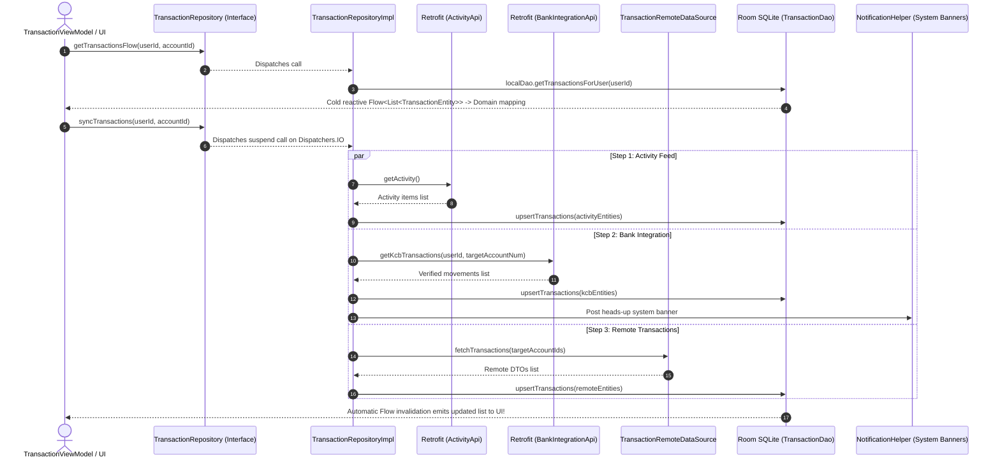

# 💳 TransactionRepository ⟷ TransactionRepositoryImpl
### End-to-End Mapping & Architectural Deep Dive

This document details the mapping between the domain interface **[`TransactionRepository`](file:///home/frank/AndroidStudioProjects/smartmoney/app/src/main/java/com/example/smartmoney/domain/repository/TransactionRepository.kt)** and its concrete data-layer orchestrator **[`TransactionRepositoryImpl`](file:///home/frank/AndroidStudioProjects/smartmoney/app/src/main/java/com/example/smartmoney/data/repository/TransactionRepositoryImpl.kt)**.

---

## 1. 📂 File Locations

- **Domain Interface (Contract)**: [`app/src/main/java/com/example/smartmoney/domain/repository/TransactionRepository.kt`](file:///home/frank/AndroidStudioProjects/smartmoney/app/src/main/java/com/example/smartmoney/domain/repository/TransactionRepository.kt)
- **Data Implementation (Worker)**: [`app/src/main/java/com/example/smartmoney/data/repository/TransactionRepositoryImpl.kt`](file:///home/frank/AndroidStudioProjects/smartmoney/app/src/main/java/com/example/smartmoney/data/repository/TransactionRepositoryImpl.kt)

---

## 2. 🏛️ High-Level Architecture & Synchronization Flow

`TransactionRepositoryImpl` acts as a **3-tier data orchestrator**:
1. **Tier 1 (Activity Feed)**: Pulls user activity feed (`/api/transactions/activity`) via `RetrofitClient.activityApi`.
2. **Tier 2 (Open Banking Ingestion)**: Ingests verified bank movements (KCB, Equity, NCBA) via `RetrofitClient.bankIntegrationApi`.
3. **Tier 3 (Remote Data Source)**: Fetches standard remote transactions strictly scoped to verified user account IDs.
4. **Local Single Source of Truth**: All streams write into Room SQLite (`TransactionDao`), triggering reactive `Flow` emissions to the UI.



---

## 3. 🔍 Method-by-Method Mapping

### Method 1: `getTransactionsFlow`

#### Domain Contract:
```kotlin
fun getTransactionsFlow(
    userId: String? = null, 
    accountId: String? = null
): Flow<List<Transaction>>
```

#### Implementation in `TransactionRepositoryImpl`:
```kotlin
override fun getTransactionsFlow(userId: String?, accountId: String?): Flow<List<Transaction>> {
    val targetUserId = userId ?: userIdProvider?.invoke()
    if (targetUserId.isNullOrBlank()) {
        return flowOf(emptyList())
    }
    val flow = if (accountId != null) {
        localDao.getTransactionsForAccount(userId = targetUserId, accountId = accountId)
    } else {
        localDao.getTransactionsForUser(userId = targetUserId)
    }
    return flow.map { list -> list.map { it.toDomain() } }
        .flowOn(dispatchers.default)
}
```

#### Mapping Breakdown:
- **Offline-First**: Returns data directly from SQLite via [`TransactionDao`](file:///home/frank/AndroidStudioProjects/smartmoney/app/src/main/java/com/example/smartmoney/data/local/dao/TransactionDao.kt). Zero network latency for initial screen rendering.
- **Filtering**: If `accountId` is specified, it filters by account; otherwise, it observes all transactions for `targetUserId`.
- **Domain Transformation**: Maps database entities (`TransactionEntity`) to pure immutable domain models (`Transaction`) using `.map { it.toDomain() }`.
- **Threading**: Uses `.flowOn(dispatchers.default)` so heavy list transformations occur off the Android Main thread.

---

### Method 2: `syncTransactions`

#### Domain Contract:
```kotlin
suspend fun syncTransactions(
    userId: String? = null, 
    accountId: String? = null
): Result<Unit>
```

#### Implementation in `TransactionRepositoryImpl`:
```kotlin
override suspend fun syncTransactions(userId: String?, accountId: String?): Result<Unit> = withContext(dispatchers.io) {
    val targetUserId = userId ?: userIdProvider?.invoke()
    if (targetUserId.isNullOrBlank()) {
        return@withContext Result.success(Unit)
    }

    try {
        // 0. Pull user-scoped activity feed from transactions-service
        syncActivityFeed(targetUserId, accountId)

        // Verify account ownership to prevent cross-user movement leaks
        val userAccounts = accountDao?.getAccountsForUserOnce(targetUserId).orEmpty()
        if (userAccounts.isEmpty()) return@withContext Result.success(Unit)

        // 1. Ingest bank-integration-service movements (:8090)
        val kcbResponse = RetrofitClient.bankIntegrationApi.getKcbTransactions(...)
        // Filter strictly against accounts owned by targetUserId & upsert to Room

        // 2. Ingest standard remote transactions from transactions-service
        val remoteDtos = remoteDataSource.fetchTransactions(targetAccountIds)
        // Upsert to Room and generate in-app bell notifications

        Result.success(Unit)
    } catch (e: Exception) {
        Result.failure(e)
    }
}
```

#### Mapping Breakdown:
- **Threading**: Enforces `withContext(dispatchers.io)` for non-blocking I/O execution.
- **Multi-Bank Ingestion**: Coordinates between `activityApi`, `bankIntegrationApi`, and `remoteDataSource`.
- **Data Isolation**: Matches incoming transactions against verified accounts in `accountDao` to ensure a user never sees another user's banking activity.
- **Notifications**: Automatically generates persisted in-app notifications in `NotificationDao` and posts Android heads-up status bar notifications via `NotificationHelper`.
- **Fault-Tolerance**: Wrapped in `try/catch` returning `Result<Unit>`, allowing callers to handle network unavailability gracefully without app crashes.

---

### Method 3: `recordTransaction`

#### Domain Contract:
```kotlin
suspend fun recordTransaction(
    transaction: Transaction, 
    userId: String? = null
): Result<Transaction>
```

#### Implementation in `TransactionRepositoryImpl`:
```kotlin
override suspend fun recordTransaction(transaction: Transaction, userId: String?): Result<Transaction> = withContext(dispatchers.io) {
    val targetUserId = userId ?: userIdProvider?.invoke() ?: ""
    try {
        val remoteDto = remoteDataSource.recordTransaction(TransactionDto.fromDomain(transaction))
        val domainTx = remoteDto.toDomain()
        localDao.upsertTransaction(TransactionEntity.fromDomain(domainTx, userId = targetUserId))
        Result.success(domainTx)
    } catch (e: Exception) {
        Result.failure(e)
    }
}
```

#### Mapping Breakdown:
- **Bi-directional Mapping**: Domain model `Transaction` is serialized to `TransactionDto` for HTTP POST, and the server response is stored into Room as `TransactionEntity`.
- **Immediate Local Cache**: Upserting the saved record into `localDao` triggers Room's reactive `Flow`, updating the UI instantly without needing a full sync.

---

## 4. 🔌 Dependency Injection Wiring in `AppContainer`

In [`AppContainer.kt`](file:///home/frank/AndroidStudioProjects/smartmoney/app/src/main/java/com/example/smartmoney/core/di/AppContainer.kt):
```kotlin
override val transactionRepository: TransactionRepository by lazy {
    TransactionRepositoryImpl(
        remoteDataSource = transactionRemoteDataSource,
        localDao = database.transactionDao(),
        accountDao = database.accountDao(),
        notificationDao = database.notificationDao(),
        userIdProvider = { authRepository.currentUserId() },
        context = context
    )
}
```

In [`MainActivity.kt`](file:///home/frank/AndroidStudioProjects/smartmoney/app/src/main/java/com/example/smartmoney/MainActivity.kt):
```kotlin
val transactionViewModel: TransactionViewModel = viewModel(
    key = "transaction_$currentUserId",
    factory = TransactionViewModel.Factory(
        repository = appContainer.transactionRepository,
        userId = currentUserId
    )
)
```

---

## 5. 💡 Key Architectural Lessons

1. **Room as the Single Source of Truth**: The ViewModel never observes Retrofit responses directly. Network responses write to Room SQLite, and Room emits updates to the ViewModel via `Flow`.
2. **Dynamic User Id Provider**: By passing a lambda `userIdProvider: () -> String?`, the repository survives across user login/logout cycles without requiring instance re-allocation.
3. **Data Security**: Strict account ownership validation prevents transactions from leaking across user sessions.
