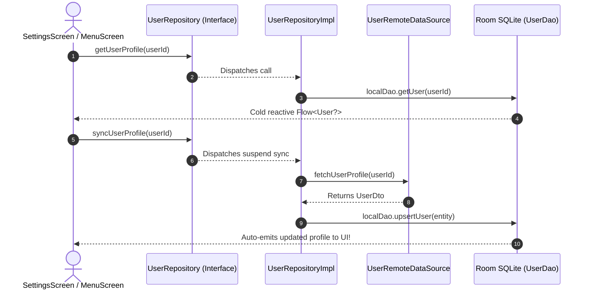

# 👤 UserRepository ⟷ UserRepositoryImpl
### End-to-End Mapping & Architectural Deep Dive

This document details the mapping between the domain interface **[`UserRepository`](file:///home/frank/AndroidStudioProjects/smartmoney/app/src/main/java/com/example/smartmoney/domain/repository/UserRepository.kt)** and its concrete data-layer orchestrator **[`UserRepositoryImpl`](file:///home/frank/AndroidStudioProjects/smartmoney/app/src/main/java/com/example/smartmoney/data/repository/UserRepositoryImpl.kt)**.

---

## 1. 📂 File Locations

- **Domain Interface (Contract)**: [`app/src/main/java/com/example/smartmoney/domain/repository/UserRepository.kt`](file:///home/frank/AndroidStudioProjects/smartmoney/app/src/main/java/com/example/smartmoney/domain/repository/UserRepository.kt)
- **Data Implementation (Worker)**: [`app/src/main/java/com/example/smartmoney/data/repository/UserRepositoryImpl.kt`](file:///home/frank/AndroidStudioProjects/smartmoney/app/src/main/java/com/example/smartmoney/data/repository/UserRepositoryImpl.kt)

---

## 2. 🏛️ High-Level Architecture & User Profile Flow

`UserRepositoryImpl` provides offline-first user profile caching and synchronization:
- Uses [`UserRemoteDataSource`](file:///home/frank/AndroidStudioProjects/smartmoney/app/src/main/java/com/example/smartmoney/data/remote/datasource/UserRemoteDataSource.kt) for fetching and updating user attributes.
- Persists user profiles into Room SQLite table `users` via [`UserDao`](file:///home/frank/AndroidStudioProjects/smartmoney/app/src/main/java/com/example/smartmoney/data/local/dao/UserDao.kt).
- Emits reactive `Flow<User?>` streams to profile, settings, and drawer headers.



---

## 3. 🔍 Method-by-Method Mapping

### Method 1: `getUserProfile`

#### Domain Contract:
```kotlin
fun getUserProfile(userId: String): Flow<User?>
```

#### Implementation in `UserRepositoryImpl`:
```kotlin
override fun getUserProfile(userId: String): Flow<User?> {
    return localDao.getUser(userId).map { it?.toDomain() }
}
```

#### Mapping Breakdown:
- **Null Safety**: Returns `Flow<User?>` emitting `null` if the user is not yet cached, preventing crashes on initial launch.
- **Reactive Cache**: Emits updates whenever profile fields (e.g., name, phone, preferences) are updated.

---

### Method 2: `syncUserProfile`

#### Domain Contract:
```kotlin
suspend fun syncUserProfile(userId: String): Result<User>
```

#### Implementation in `UserRepositoryImpl`:
```kotlin
override suspend fun syncUserProfile(userId: String): Result<User> {
    return try {
        val remoteUserDto = remoteDataSource.fetchUserProfile(userId)
            ?: return Result.failure(NoSuchElementException("User profile not found"))
        val domainUser = remoteUserDto.toDomain()
        localDao.upsertUser(UserEntity.fromDomain(domainUser))
        Result.success(domainUser)
    } catch (e: Exception) {
        Result.failure(e)
    }
}
```

#### Mapping Breakdown:
- Fetches profile DTO from the server, maps it to domain model `User`, and writes it into Room SQLite.
- Returns `Result.success(domainUser)` for instant consumption by callers.

---

### Method 3: `updateUserProfile`

#### Domain Contract:
```kotlin
suspend fun updateUserProfile(user: User): Result<Unit>
```

#### Implementation in `UserRepositoryImpl`:
```kotlin
override suspend fun updateUserProfile(user: User): Result<Unit> {
    return try {
        remoteDataSource.updateUserProfile(UserDto.fromDomain(user))
        localDao.upsertUser(UserEntity.fromDomain(user))
        Result.success(Unit)
    } catch (e: Exception) {
        Result.failure(e)
    }
}
```

#### Mapping Breakdown:
- **Write-Through Caching**: Updates both the remote backend database and the local Room SQLite cache.
- The Room update immediately triggers `getUserProfile` flows, keeping all observing screens in sync.

---

## 4. 💡 Key Architectural Lessons

1. **Write-Through Consistency**: Ensuring remote updates and local cache writes occur together prevents visual stale-data flickers when navigating between screens.
2. **DTO to Domain Decoupling**: Database schema alterations in `UserEntity` or JSON changes in `UserDto` never affect UI components because the domain `User` model acts as a protective buffer.
