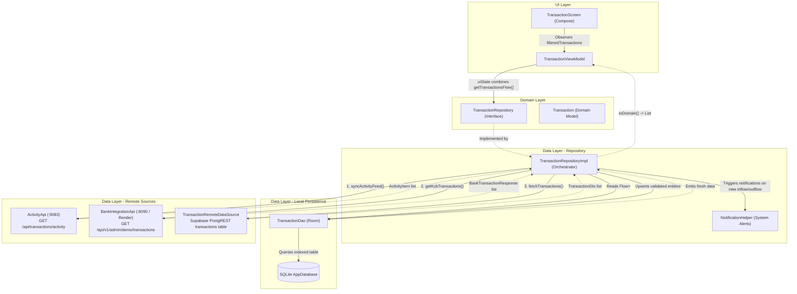
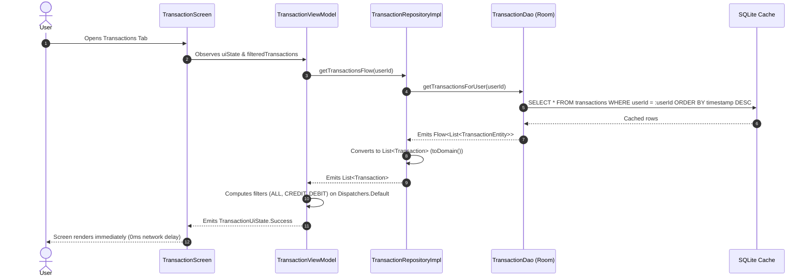
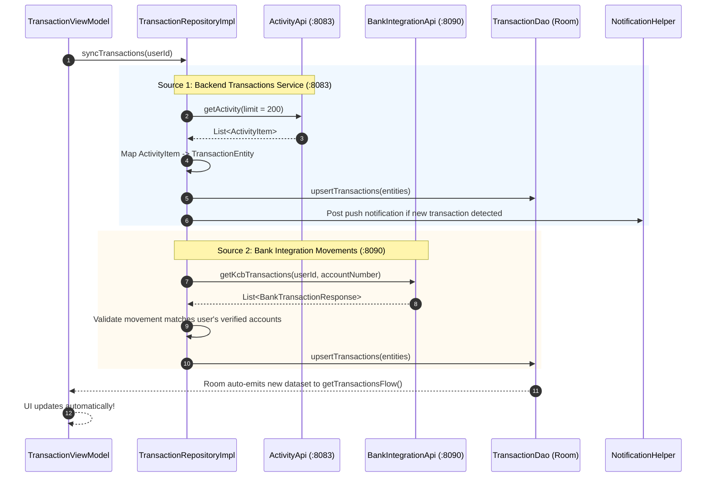
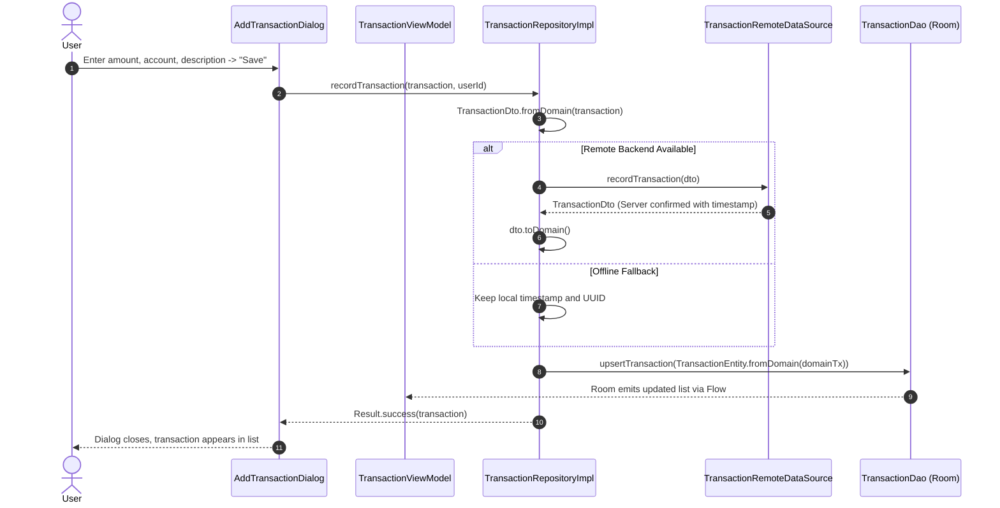

# 01. Transaction Architecture & End-to-End Data Flow

This document details the architectural layout, data pipelines, and request journeys of the **Transaction System** in SmartMoney.

---

## 1. High-Level Architectural Flow

SmartMoney implements an **Offline-First Multi-Source Transaction Pipeline**. Transactions are ingested from three possible backends, normalized into Room database entities, and reactively pushed to the UI via Kotlin `Flow`.



---

## 2. Core Request Journeys

### Journey 1: Viewing Transactions (Offline-First Flow)

SmartMoney prioritizes instant startup and zero-latency rendering. The UI **never** waits for the network before rendering transactions.



1. **Instant Render**: Even if the device is in Airplane Mode, Room emits the cached transactions immediately.
2. **Background Thread Computation**: Filtering (`CREDIT` vs `DEBIT`) runs on `Dispatchers.Default` inside the ViewModel, preventing UI lag or jank during scrolling.

---

### Journey 2: Syncing Remote Transactions & Deduplication

When the screen mounts or a pull-to-refresh is triggered, [`TransactionRepositoryImpl.syncTransactions()`](file:///home/frank/AndroidStudioProjects/smartmoney/app/src/main/java/com/example/smartmoney/data/repository/TransactionRepositoryImpl.kt#L59) synchronizes external transactions from all active backends.



#### Key Safeguards in Syncing:
1. **User Account Verification**: In [`TransactionRepositoryImpl.kt`](file:///home/frank/AndroidStudioProjects/smartmoney/app/src/main/java/com/example/smartmoney/data/repository/TransactionRepositoryImpl.kt#L80-L105), incoming bank movements are strictly validated against accounts owned by the signed-in `userId`. Unrelated bank movements are dropped immediately to prevent cross-user data leakage.
2. **Notification Deduplication**: An in-memory synchronized set (`alertedTxIds`) tracks posted notification IDs so users never receive duplicate push alerts for the same movement.

---

### Journey 3: Recording a Transaction (Creating / Adding)

When a manual transaction or payment is recorded:



---

### Journey 4: The Push Notification Trigger

In [`TransactionRepositoryImpl.kt`](file:///home/frank/AndroidStudioProjects/smartmoney/app/src/main/java/com/example/smartmoney/data/repository/TransactionRepositoryImpl.kt#L390-L402):
Whenever new movements are fetched from [`ActivityApi`](file:///home/frank/AndroidStudioProjects/smartmoney/app/src/main/java/com/example/smartmoney/data/remote/api/ActivityApi.kt), the repository checks if it has previously alerted the user:

```kotlin
if (!alertedTxIds.add("activity_${item.id}")) continue

val isCredit = !item.direction.equals("DEBIT", ignoreCase = true)
val bankUpper = (item.bank?.takeIf { it.isNotBlank() } ?: "Bank").uppercase(Locale.ROOT)
val formatted = DecimalFormat("#,##0.00").format(item.amount)
val currency = item.currency ?: "KES"

NotificationHelper.postSystemNotification(
    context,
    if (isCredit) "$bankUpper Inflow Received" else "$bankUpper Outflow Paid",
    if (isCredit) "+$currency $formatted credited • $note" else "-$currency $formatted debited • $note"
)
```
This guarantees real-time feedback on user deposits and withdrawals without requiring external FCM services.
