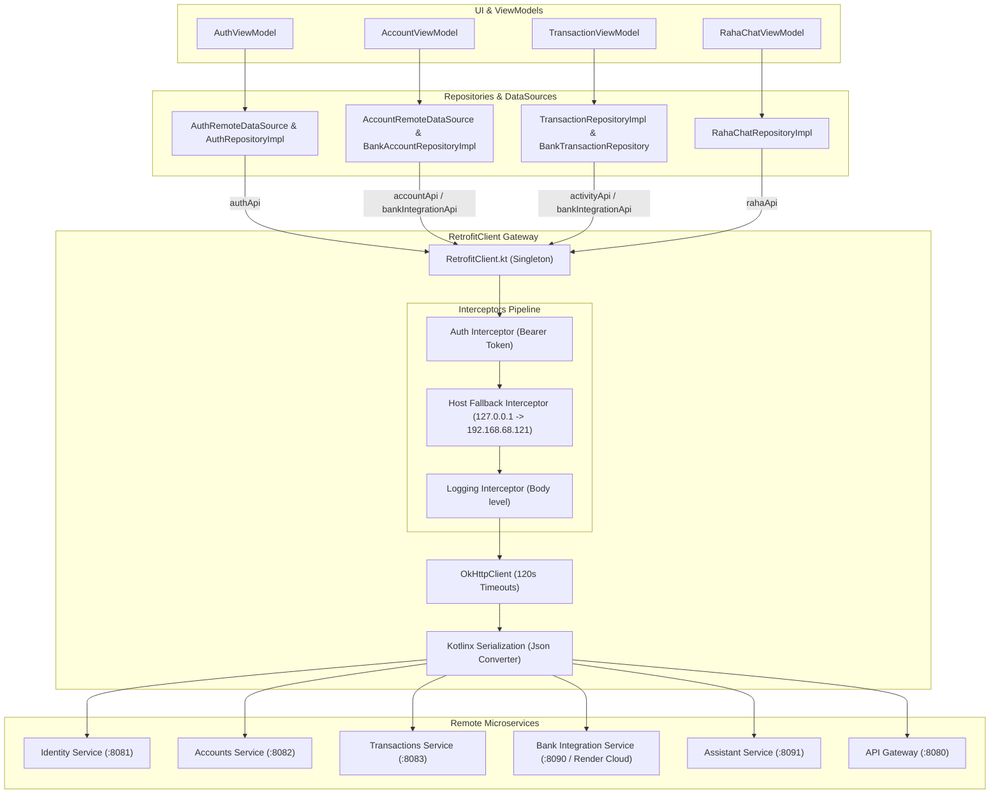

# Retrofit & Network Architecture Documentation

Welcome to the documentation for [`RetrofitClient.kt`](file:///home/frank/AndroidStudioProjects/smartmoney/app/src/main/java/com/example/smartmoney/data/remote/RetrofitClient.kt).

This document breaks down the entire networking client of the **SmartMoney** Android application. It explains **what each line of code does**, **how OkHttp interceptors and serialization work**, and **how every API interface connects to the rest of the application**.

> [!TIP]
> For a deep-dive on how DataSources and RetrofitClient collaborate on **JWT tokens, session lifecycles, and authorization headers**, see:
> 📄 [**DataSource & RetrofitClient Collaboration Guide**](file:///home/frank/AndroidStudioProjects/smartmoney/retrofit/DATASOURCE_AND_RETROFIT_COLLABORATION.md)

---

## 1. Architectural Overview

[`RetrofitClient`](file:///home/frank/AndroidStudioProjects/smartmoney/app/src/main/java/com/example/smartmoney/data/remote/RetrofitClient.kt) is a Kotlin singleton (`object`) that serves as the central HTTP gateway for the application. It manages connections to multiple Spring Boot microservices, cloud deployments (Render), and local backend servers.



---

## 2. Line-by-Line Code Breakdown

Below is a detailed analysis of every block and line in [`RetrofitClient.kt`](file:///home/frank/AndroidStudioProjects/smartmoney/app/src/main/java/com/example/smartmoney/data/remote/RetrofitClient.kt):

### Lines 1–13: Package & Imports
```kotlin
package com.example.smartmoney.data.remote

import com.example.smartmoney.data.remote.api.AccountApi
import com.example.smartmoney.data.remote.api.AuthApi
import com.example.smartmoney.data.remote.api.BankIntegrationApi
import kotlinx.serialization.json.Json
import okhttp3.MediaType.Companion.toMediaType
import okhttp3.OkHttpClient
import okhttp3.logging.HttpLoggingInterceptor
import retrofit2.Retrofit
import retrofit2.converter.kotlinx.serialization.asConverterFactory
import java.util.concurrent.TimeUnit
```
* **Line 1**: Places this file in the remote data package (`com.example.smartmoney.data.remote`).
* **Lines 3–5**: Imports Retrofit service interfaces that define endpoints for Accounts, Authentication, and Bank Integrations.
* **Lines 6–12**: Imports networking and serialization libraries:
  * `kotlinx.serialization.json.Json`: High-performance JSON parser.
  * `OkHttpClient`: The underlying HTTP engine managing connections, pools, and timeouts.
  * `HttpLoggingInterceptor`: Logs network requests/responses to Android Logcat.
  * `asConverterFactory`: Bridges Kotlin Serialization with Retrofit.
  * `TimeUnit`: Configures connection and read timeouts.

---

### Lines 14–36: Singleton Declaration & Microservice Port Registry
```kotlin
object RetrofitClient {

    var host: String = "127.0.0.1"
    var gatewayPort: Int? = null

    const val IDENTITY_PORT = 8081
    const val ACCOUNTS_PORT = 8082
    const val TRANSACTIONS_PORT = 8083
    const val BANK_INTEGRATION_PORT = 8090
    const val ASSISTANT_PORT = 8091
```
* **Line 26 (`object RetrofitClient`)**: Creates a thread-safe **Singleton**. Only one instance exists in memory, preserving HTTP connection pooling and caching.
* **Line 28 (`var host`)**: Default IP address for local backend services. Set to `127.0.0.1` (localhost).
* **Line 29 (`var gatewayPort`)**: When non-null (e.g. `8080`), all requests route through the centralized Spring Boot API Gateway rather than individual ports.
* **Lines 31–35 (`const val ..._PORT`)**: Defines the dedicated port numbers for each backend microservice:
  * `8081`: **Identity Service** (User registration, login, JWT issuance).
  * `8082`: **Accounts Service** (Account balances, metadata, limits).
  * `8083`: **Transactions Service** (Transaction ledger and movement history).
  * `8090`: **Bank Integration Service** (KCB, Equity, Stanbic banking integrations).
  * `8091`: **Assistant Service** (Raha AI financial assistant).

---

### Lines 37–58: Bank Integration Dual-Hosting & Dynamic Reassignment
```kotlin
    const val BANK_INTEGRATION_RENDER_URL: String = "https://bank-integration-service.onrender.com/"

    var bankIntegrationBaseUrl: String = try {
        val field = com.example.smartmoney.BuildConfig::class.java.getField("BANK_INTEGRATION_URL")
        (field.get(null) as? String)?.takeIf { it.isNotBlank() } ?: BANK_INTEGRATION_RENDER_URL
    } catch (_: Throwable) {
        BANK_INTEGRATION_RENDER_URL
    }
        set(value) {
            field = if (value.endsWith("/")) value else "$value/"
            _bankIntegrationApi = null
        }

    private var _bankIntegrationApi: BankIntegrationApi? = null
```
* **Line 40**: The live cloud deployment URL hosted on Render.
* **Lines 46–55**: Resolves the base URL using reflection to check if `BuildConfig.BANK_INTEGRATION_URL` is defined; if not, falls back to the live Render deployment.
* **Line 52–55 (`set(value)`)**: Whenever `bankIntegrationBaseUrl` is modified, it ensures a trailing slash and resets `_bankIntegrationApi = null` so the next call rebuilds the Retrofit adapter with the new base URL.
* **Line 57**: Backing cache property for the bank integration client.

---

### Lines 59–63: Dynamic JWT Authentication Provider
```kotlin
    /**
     * Provider supplying the active JWT authentication token.
     */
    var tokenProvider: (() -> String?)? = null
```
* **Line 62**: A functional property (lambda `() -> String?`).
* **Connection**: [`AuthRemoteDataSource.kt`](file:///home/frank/AndroidStudioProjects/smartmoney/app/src/main/java/com/example/smartmoney/data/remote/datasource/AuthRemoteDataSource.kt#L34) sets this during app startup or login:
  ```kotlin
  RetrofitClient.tokenProvider = { authToken }
  ```
  This allows OkHttp interceptors to retrieve the active JWT token without creating circular dependencies.

---

### Lines 64–70: Kotlinx Serialization Configuration
```kotlin
    private val json = Json {
        ignoreUnknownKeys = true
        isLenient = true
        encodeDefaults = true
        coerceInputValues = true
    }
```
* `ignoreUnknownKeys = true`: Prevents crashes when the backend sends new JSON fields that the Android app has not declared yet.
* `isLenient = true`: Allows parsing slightly malformed or unquoted JSON.
* `encodeDefaults = true`: Ensures default property values in Kotlin data classes are included in serialized request bodies.
* `coerceInputValues = true`: Converts nulls to default values if null is received for non-nullable properties with default values.

---

### Lines 71–82: Authentication Interceptor (`authInterceptor`)
```kotlin
    private val authInterceptor = okhttp3.Interceptor { chain ->
        val original = chain.request()
        val token = tokenProvider?.invoke()
        val request = if (!token.isNullOrBlank() && original.header("Authorization") == null) {
            original.newBuilder()
                .header("Authorization", "Bearer $token")
                .build()
        } else {
            original
        }
        chain.proceed(request)
    }
```
* Intercepts **every single HTTP request** leaving the application.
* Invokes `tokenProvider?.invoke()` to check for an active user token.
* If a token exists and no `Authorization` header is present, it injects `Authorization: Bearer <token>`.
* Guarantees that protected endpoints (accounts, transactions, assistant) are authorized seamlessly.

---

### Lines 84–106: Host Fallback Interceptor (`hostFallbackInterceptor`)
```kotlin
    const val FALLBACK_HOST: String = "192.168.68.121"

    private val hostFallbackInterceptor = okhttp3.Interceptor { chain ->
        val request = chain.request()
        val originalUrl = request.url
        try {
            chain.proceed(request)
        } catch (e: Exception) {
            if ((e is java.net.ConnectException || e is java.net.SocketTimeoutException) &&
                (originalUrl.host == "127.0.0.1" || originalUrl.host == "localhost")
            ) {
                val newUrl = originalUrl.newBuilder()
                    .host(FALLBACK_HOST)
                    .build()
                val newRequest = request.newBuilder()
                    .url(newUrl)
                    .build()
                chain.proceed(newRequest)
            } else {
                throw e
            }
        }
    }
```
* **Why this exists**: When testing on a physical Android phone or emulator, `127.0.0.1` refers to the phone itself rather than the development computer running the Spring Boot services.
* **How it works**: If a request to `127.0.0.1` or `localhost` fails with a `ConnectException` or `SocketTimeoutException`, it transparently rewrites the URL host to `192.168.68.121` (your development computer on the local Wi-Fi) and retries the request automatically.

---

### Lines 107–120: Logging Interceptor & OkHttpClient Configuration
```kotlin
    private val loggingInterceptor = HttpLoggingInterceptor().apply {
        level = HttpLoggingInterceptor.Level.BODY
    }

    private val okHttpClient: OkHttpClient = OkHttpClient.Builder()
        .addInterceptor(authInterceptor)
        .addInterceptor(hostFallbackInterceptor)
        .addInterceptor(loggingInterceptor)
        .connectTimeout(120, TimeUnit.SECONDS)
        .readTimeout(120, TimeUnit.SECONDS)
        .writeTimeout(120, TimeUnit.SECONDS)
        .build()
```
* **Lines 108–110**: Configures full request and response body logging to Android Logcat (tag `OkHttp`).
* **Lines 112–115**: Chains the interceptors in order:
  1. Add Auth headers
  2. Handle network fallback
  3. Log final request and response
* **Lines 116–118 (120-second timeouts)**: Free-tier Render web services spin down after inactivity. A 120-second timeout ensures the app does not prematurely time out while the backend instance boots up from a cold start.

---

### Lines 121–146: Dynamic Retrofit Builders
```kotlin
    private val deployedGateway: String = com.example.smartmoney.BuildConfig.API_BASE_URL.trim().trimEnd('/')

    private fun buildRetrofit(servicePort: Int): Retrofit {
        val port = gatewayPort ?: servicePort
        val baseUrl = if (deployedGateway.isNotEmpty()) "$deployedGateway/" else "http://$host:$port/"
        return Retrofit.Builder()
            .baseUrl(baseUrl)
            .client(okHttpClient)
            .addConverterFactory(json.asConverterFactory("application/json".toMediaType()))
            .build()
    }

    private fun buildRetrofitWithBaseUrl(baseUrl: String): Retrofit {
        val normalizedUrl = if (baseUrl.endsWith("/")) baseUrl else "$baseUrl/"
        return Retrofit.Builder()
            .baseUrl(normalizedUrl)
            .client(okHttpClient)
            .addConverterFactory(json.asConverterFactory("application/json".toMediaType()))
            .build()
    }
```
* **`deployedGateway`**: Reads `API_BASE_URL` from `local.properties` via `BuildConfig`.
* **`buildRetrofit(servicePort)`**:
  * If a central deployed gateway URL is defined, routes requests through it.
  * Otherwise, builds `http://$host:$port/` targeting the specific microservice port.
* **`buildRetrofitWithBaseUrl(baseUrl)`**: Builds a Retrofit instance for independent domains (e.g. Render cloud).

---

### Lines 148–199: API Interface Singletons & Helpers

#### 1. Identity Service (`authApi`)
```kotlin
    val authApi: AuthApi by lazy {
        buildRetrofit(IDENTITY_PORT).create(AuthApi::class.java)
    }
```
* **Port**: `8081`
* **Target Interface**: [`AuthApi.kt`](file:///home/frank/AndroidStudioProjects/smartmoney/app/src/main/java/com/example/smartmoney/data/remote/api/AuthApi.kt)
* **Endpoints**: `POST /api/auth/register`, `POST /api/auth/login`
* **Connected To**:
  * [`AuthRemoteDataSource.kt`](file:///home/frank/AndroidStudioProjects/smartmoney/app/src/main/java/com/example/smartmoney/data/remote/datasource/AuthRemoteDataSource.kt)
  * [`AuthRepositoryImpl.kt`](file:///home/frank/AndroidStudioProjects/smartmoney/app/src/main/java/com/example/smartmoney/data/repository/AuthRepositoryImpl.kt)

#### 2. Accounts Service (`accountApi`)
```kotlin
    val accountApi: AccountApi by lazy {
        buildRetrofit(ACCOUNTS_PORT).create(AccountApi::class.java)
    }
```
* **Port**: `8082`
* **Target Interface**: [`AccountApi.kt`](file:///home/frank/AndroidStudioProjects/smartmoney/app/src/main/java/com/example/smartmoney/data/remote/api/AccountApi.kt)
* **Endpoints**: `GET /api/accounts`, `POST /api/accounts`, `PUT /api/accounts/{id}/balance`
* **Connected To**:
  * [`AccountRemoteDataSource.kt`](file:///home/frank/AndroidStudioProjects/smartmoney/app/src/main/java/com/example/smartmoney/data/remote/datasource/AccountRemoteDataSource.kt)
  * [`BankAccountRepositoryImpl.kt`](file:///home/frank/AndroidStudioProjects/smartmoney/app/src/main/java/com/example/smartmoney/data/repository/BankAccountRepositoryImpl.kt)

#### 3. Transactions Activity Service (`activityApi`)
```kotlin
    val activityApi: com.example.smartmoney.data.remote.api.ActivityApi by lazy {
        buildRetrofit(TRANSACTIONS_PORT).create(com.example.smartmoney.data.remote.api.ActivityApi::class.java)
    }
```
* **Port**: `8083`
* **Target Interface**: [`ActivityApi.kt`](file:///home/frank/AndroidStudioProjects/smartmoney/app/src/main/java/com/example/smartmoney/data/remote/api/ActivityApi.kt)
* **Endpoints**: `GET /api/transactions/activity`
* **Connected To**:
  * [`TransactionRepositoryImpl.kt`](file:///home/frank/AndroidStudioProjects/smartmoney/app/src/main/java/com/example/smartmoney/data/repository/TransactionRepositoryImpl.kt) (pulls real money-in and money-out records)

#### 4. Bank Integration Service (`bankIntegrationApi`)
```kotlin
    val bankIntegrationApi: BankIntegrationApi
        get() = _bankIntegrationApi ?: buildRetrofitWithBaseUrl(bankIntegrationBaseUrl)
            .create(BankIntegrationApi::class.java)
            .also { _bankIntegrationApi = it }

    fun useLocalBankIntegration() {
        bankIntegrationBaseUrl = "http://$host:$BANK_INTEGRATION_PORT/"
    }

    fun useRenderBankIntegration() {
        bankIntegrationBaseUrl = BANK_INTEGRATION_RENDER_URL
    }
```
* **Target URL**: Defaults to Render (`https://bank-integration-service.onrender.com/`), switchable to local (`:8090`).
* **Target Interface**: [`BankIntegrationApi.kt`](file:///home/frank/AndroidStudioProjects/smartmoney/app/src/main/java/com/example/smartmoney/data/remote/api/BankIntegrationApi.kt)
* **Endpoints**: Account linking (`/api/v1/admin/account-links`), KCB movement querying (`/api/v1/admin/demo/transactions`), health checks.
* **Connected To**:
  * [`BankAccountRepositoryImpl.kt`](file:///home/frank/AndroidStudioProjects/smartmoney/app/src/main/java/com/example/smartmoney/data/repository/BankAccountRepositoryImpl.kt)
  * [`BankTransactionRepository.kt`](file:///home/frank/AndroidStudioProjects/smartmoney/app/src/main/java/com/example/smartmoney/data/repository/BankTransactionRepository.kt)
  * [`TransactionRepositoryImpl.kt`](file:///home/frank/AndroidStudioProjects/smartmoney/app/src/main/java/com/example/smartmoney/data/repository/TransactionRepositoryImpl.kt)
  * [`AccountViewModel.kt`](file:///home/frank/AndroidStudioProjects/smartmoney/app/src/main/java/com/example/smartmoney/ui/accounts/AccountViewModel.kt)
  * [`TransactionViewModel.kt`](file:///home/frank/AndroidStudioProjects/smartmoney/app/src/main/java/com/example/smartmoney/ui/transactions/TransactionViewModel.kt)

#### 5. AI Assistant Service (`rahaApi`)
```kotlin
    val rahaApi: com.example.smartmoney.data.remote.api.RahaApi by lazy {
        buildRetrofit(ASSISTANT_PORT).create(com.example.smartmoney.data.remote.api.RahaApi::class.java)
    }
```
* **Port**: `8091`
* **Target Interface**: [`RahaApi.kt`](file:///home/frank/AndroidStudioProjects/smartmoney/app/src/main/java/com/example/smartmoney/data/remote/api/RahaApi.kt)
* **Endpoints**: `POST /api/assistant/chat`, `DELETE /api/assistant/conversations/{id}`
* **Connected To**:
  * Raha AI assistant conversation handlers and screens.

---

## 3. Comprehensive Connection Matrix

| Property | Interface | Backend Service & Port | Caller in SmartMoney | Feature / Purpose |
| :--- | :--- | :--- | :--- | :--- |
| `authApi` | [`AuthApi`](file:///home/frank/AndroidStudioProjects/smartmoney/app/src/main/java/com/example/smartmoney/data/remote/api/AuthApi.kt) | Identity Service (`:8081`) | [`AuthRemoteDataSource`](file:///home/frank/AndroidStudioProjects/smartmoney/app/src/main/java/com/example/smartmoney/data/remote/datasource/AuthRemoteDataSource.kt), [`AuthRepositoryImpl`](file:///home/frank/AndroidStudioProjects/smartmoney/app/src/main/java/com/example/smartmoney/data/repository/AuthRepositoryImpl.kt) | User Login & Registration |
| `accountApi` | [`AccountApi`](file:///home/frank/AndroidStudioProjects/smartmoney/app/src/main/java/com/example/smartmoney/data/remote/api/AccountApi.kt) | Accounts Service (`:8082`) | [`AccountRemoteDataSource`](file:///home/frank/AndroidStudioProjects/smartmoney/app/src/main/java/com/example/smartmoney/data/remote/datasource/AccountRemoteDataSource.kt), [`BankAccountRepositoryImpl`](file:///home/frank/AndroidStudioProjects/smartmoney/app/src/main/java/com/example/smartmoney/data/repository/BankAccountRepositoryImpl.kt) | Creating & managing bank/wallet accounts |
| `activityApi` | [`ActivityApi`](file:///home/frank/AndroidStudioProjects/smartmoney/app/src/main/java/com/example/smartmoney/data/remote/api/ActivityApi.kt) | Transactions Service (`:8083`) | [`TransactionRepositoryImpl`](file:///home/frank/AndroidStudioProjects/smartmoney/app/src/main/java/com/example/smartmoney/data/repository/TransactionRepositoryImpl.kt) | Live money in/out feeds matching web dashboard |
| `bankIntegrationApi` | [`BankIntegrationApi`](file:///home/frank/AndroidStudioProjects/smartmoney/app/src/main/java/com/example/smartmoney/data/remote/api/BankIntegrationApi.kt) | Bank Integration (`:8090` / Render) | [`BankAccountRepositoryImpl`](file:///home/frank/AndroidStudioProjects/smartmoney/app/src/main/java/com/example/smartmoney/data/repository/BankAccountRepositoryImpl.kt), [`BankTransactionRepository`](file:///home/frank/AndroidStudioProjects/smartmoney/app/src/main/java/com/example/smartmoney/data/repository/BankTransactionRepository.kt), [`AccountViewModel`](file:///home/frank/AndroidStudioProjects/smartmoney/app/src/main/java/com/example/smartmoney/ui/accounts/AccountViewModel.kt), [`TransactionViewModel`](file:///home/frank/AndroidStudioProjects/smartmoney/app/src/main/java/com/example/smartmoney/ui/transactions/TransactionViewModel.kt) | Bank linking (KCB, Equity, Stanbic), movements, demo simulations |
| `rahaApi` | [`RahaApi`](file:///home/frank/AndroidStudioProjects/smartmoney/app/src/main/java/com/example/smartmoney/data/remote/api/RahaApi.kt) | Assistant Service (`:8091`) | Raha AI ViewModels | Financial insights, budgeting advice, AI chat |
| `tokenProvider` | Lambda `() -> String?` | In-memory token storage | [`AuthRemoteDataSource`](file:///home/frank/AndroidStudioProjects/smartmoney/app/src/main/java/com/example/smartmoney/data/remote/datasource/AuthRemoteDataSource.kt) | Attaches active JWT to headers for all authenticated requests |
